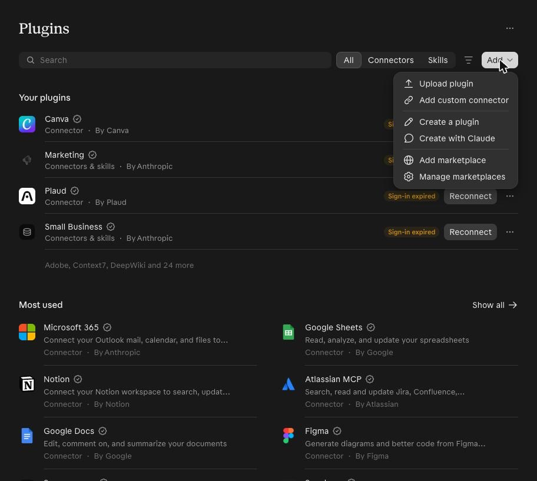
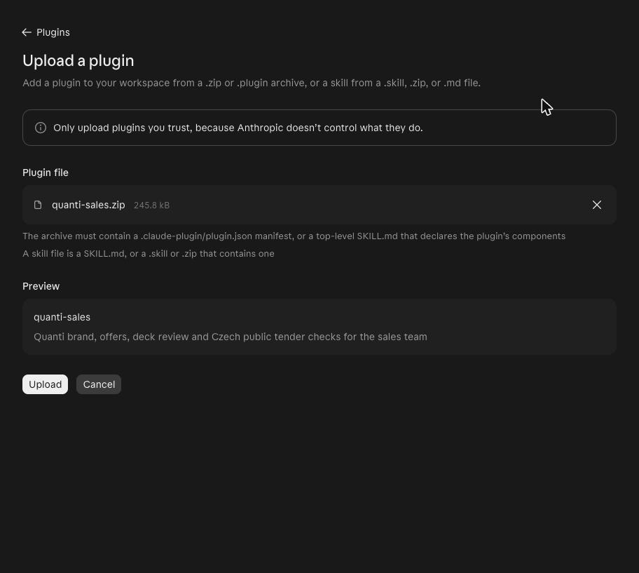
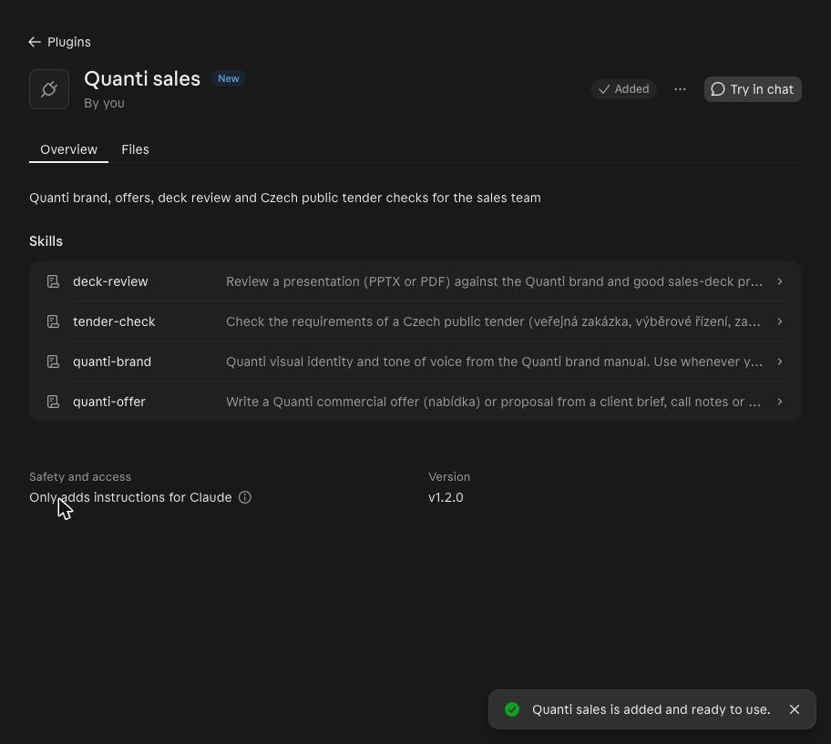
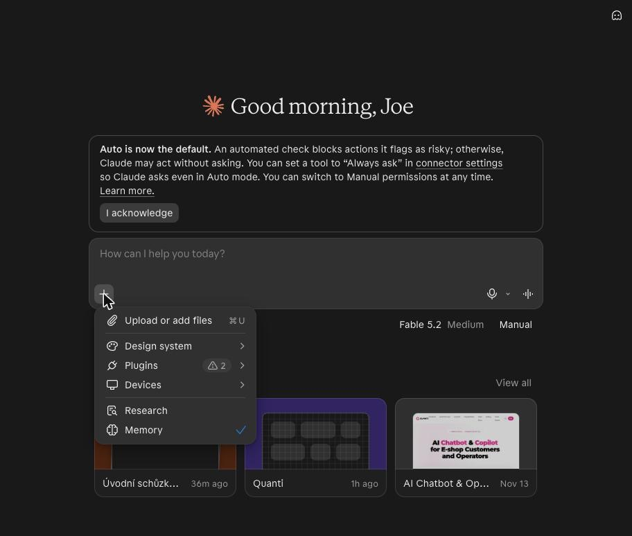
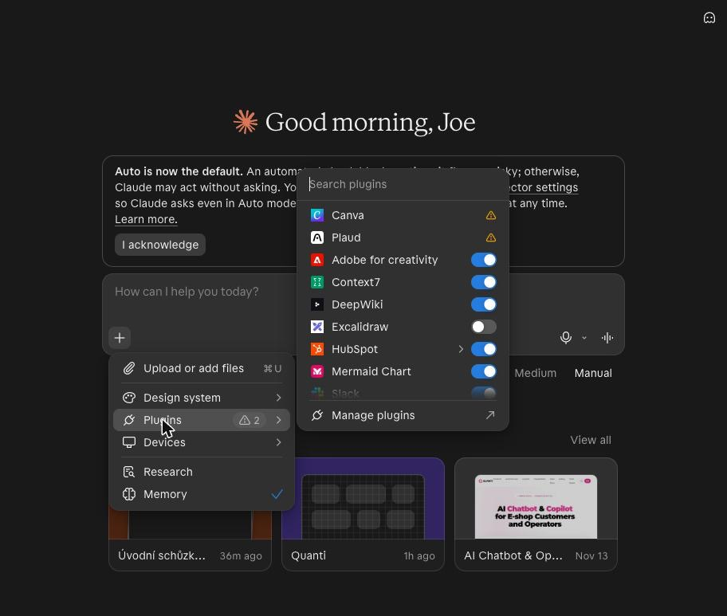
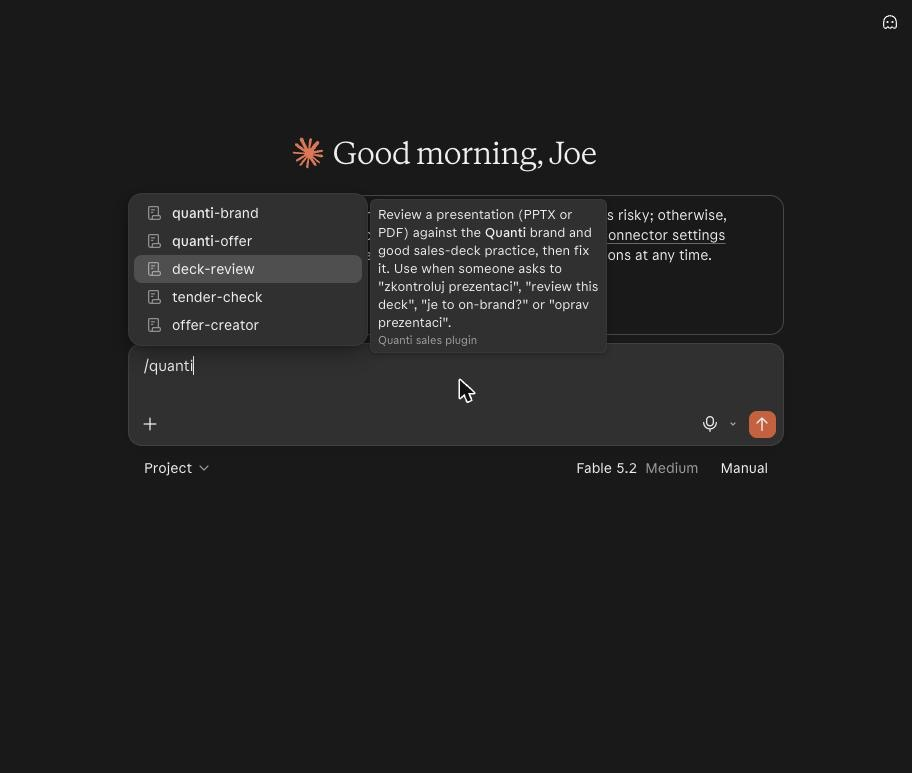
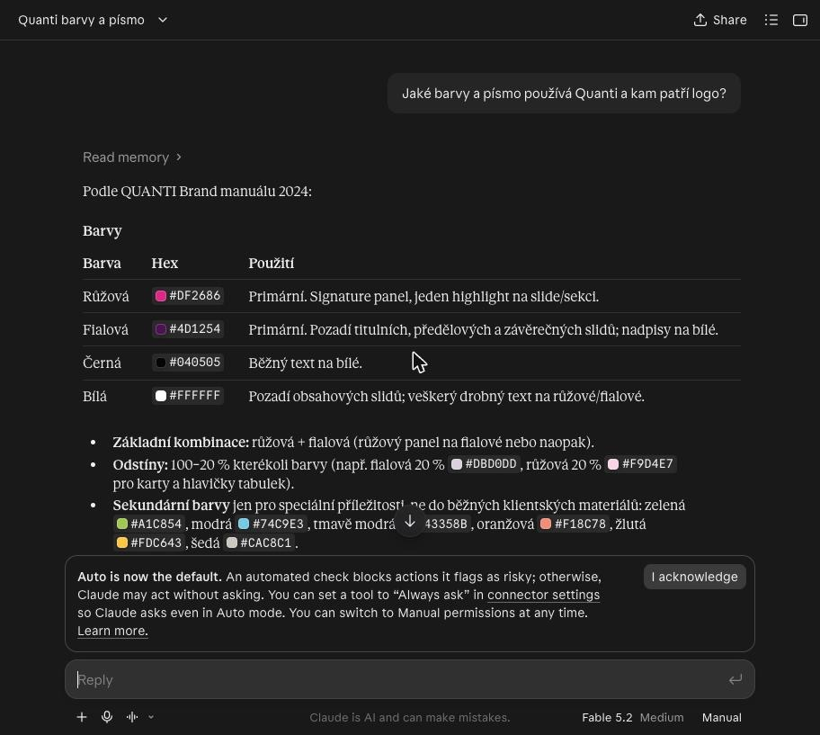

> 🌍 Read this in: [English](01-setup.md) | **Česky**

# 01 · Nastavení krok za krokem

Snímky jsou z claude.ai v prohlížeči; desktopová aplikace Claude ukazuje stejné obrazovky. Kde
se desktopová aplikace liší, krok to říká.

## Cvičení 0, krok 0 · Než pošlete první prompt (všichni, 10 min)

Nic se nedělá předem; všechno tohle proběhne na začátku workshopu.

1. **Otevřete desktopovou aplikaci Claude** (kdo ji nemá, nainstaluje z
   [claude.com/download](https://claude.com/download)) a přihlaste se účtem Quanti. Vlevo dole
   musí být vaše jméno.
2. **Nainstalujte Montserrat**: ve Finderu otevřete `~/Documents/qti-cowork-sales/sample-data/brand/fonts/`,
   označte čtyři soubory `Montserrat-*.ttf`, dvojklik → **Instalovat**. Bez něj PowerPoint a Word
   ukážou prezentace jiným písmem.
3. **Rozbalte balíček workshopu** (`qti-cowork-sales.zip`) tak, aby existovala složka
   `~/Documents/qti-cowork-sales/sample-data`.
4. **Zkontrolujte plugin**: Claude → levý panel **Plugins** → v seznamu „Your plugins“ má být
   **Quanti sales**. Pokud není, nahrajete ho v den workshopu v kroku 5.
5. **Připojte HubSpot**: Claude → **Plugins** → hledejte „HubSpot“ → **Connect** → přihlaste se
   svým účtem do HubSpotu a povolte přístup. Zpět v Plugins musí být HubSpot bez štítku
   „Sign-in expired“.
6. **Vyberte deal**: jeden svůj otevřený deal v HubSpotu s aspoň jedním zalogovaným e-mailem
   nebo hovorem. Zapište si jeho název; potřebujete ho ve cvičení 9.
7. Mějte po ruce PowerPoint, Word a Excel (nebo Keynote, Pages, Numbers).

## Cvičení 0, kroky 1–3 (10 min)

### Krok 1 · Nahrání pluginu (přeskočte, pokud „Quanti sales“ v Plugins už je)

1. Levý panel → **Plugins**.
2. Vpravo nahoře → **Add** → **Upload plugin**.

   

3. Klikněte na **browse** a vyberte `~/Documents/qti-cowork-sales/dist/quanti-sales.zip`.
   V náhledu musí být **quanti-sales** s popisem „Quanti brand, decks on the official template…“.

   

4. Klikněte na **Upload**. Otevře se stránka pluginu: **Quanti sales · Added**, verze 1.3.0
   a pět skillů: `deck-review`, `tender-check`, `quanti-brand`, `quanti-offer`, `deal-brief`.

   

   Pokud stránka ukazuje čtyři skilly nebo verzi 1.2.0, je nainstalovaný starý plugin: na
   stránce Plugins otevřete menu **…** u Quanti sales → **Remove** a nahrajte znovu.

### Krok 2 · Nová konverzace s pracovní složkou

1. Levý panel → **New**. V desktopové aplikaci se nová konverzace otevře v režimu **Cowork**
   (ikona se složkou nahoře v panelu); na claude.ai zvolte záložku **Claude**.
2. Klikněte na **+** vlevo dole v poli pro zprávu.

   

3. Desktopová aplikace: na dotaz, ve které složce smí Claude pracovat, zvolte
   `~/Documents/qti-cowork-sales/sample-data`. Prohlížeč: nejdřív **Devices → váš Mac**, pak
   složku. Všechny výstupy Claude ukládá do této složky, vedle podkladů.
4. Ve stejném menu + zkontrolujte **Plugins**: **Quanti sales** musí být zapnutý (přepínač
   vpravo). Pro cvičení 9 i HubSpot.

   

> Pracujte na kopiích. Claude může soubory ve složce přepsat. Pro skutečnou práci s klienty mu
> dejte složku projektu, nikdy celé Dokumenty.

### Krok 3 · Rychlý test

1. Do pole pro zprávu napište `/` a pak `quanti`. Menu ukáže skilly pluginu. Stiskněte
   **Escape** (chtěli jste je jen vidět).

   

2. Vložte a odešlete:

   ```
   Jaké barvy a písmo používá Quanti a kam patří logo?
   ```

3. Odpověď musí obsahovat `#DF2686`, `#4D1254`, **Montserrat** (Arial jako systémové písmo)
   a „logo vždy v pravém dolním rohu“.

   

## Když něco nejde

| Co vidíte | Proč | Udělejte |
|---|---|---|
| Obecná odpověď o brandu | Plugin vypnutý nebo nenainstalovaný | + → Plugins → zapnout Quanti sales; nebo začněte prompt „Použij skill quanti-brand.“ |
| Tlačítko „Upload“ zůstává šedé | Není vybraný soubor nebo je špatný typ | Vyberte `.zip` z `dist/`, ne složku |
| Claude se znovu ptá na složku | Každá nová konverzace začíná bez složky | Dejte mu `sample-data` znovu (krok 2) |
| Prezentace se otevírají v Arialu/Calibri | Na tomto Macu není Montserrat | Krok 0.2 |
| HubSpot ukazuje „Sign-in expired“ | Vypršel token | Plugins → HubSpot → **Reconnect** |

## Jak to funguje

Když pošlete zprávu, Claude vidí **popisy** všech nainstalovaných skillů. Popis `quanti-brand`
říká „použij, kdykoli vytváříš cokoli, co uvidí klient“, takže se načte u prezentací a nabídek,
i když ho nejmenujete. Jmenovat skill (`/quanti-brand` nebo „Použij skill quanti-brand“) je na
workshopu spolehlivější.
