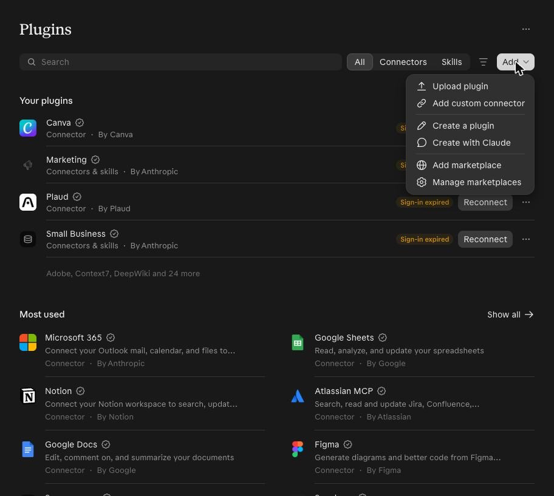
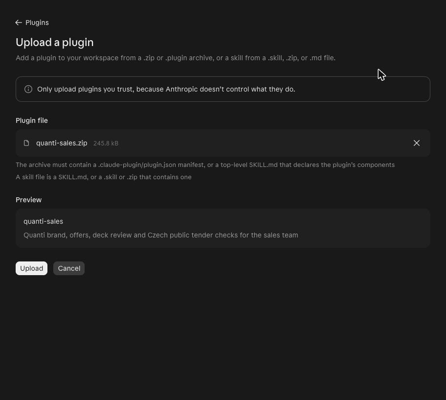
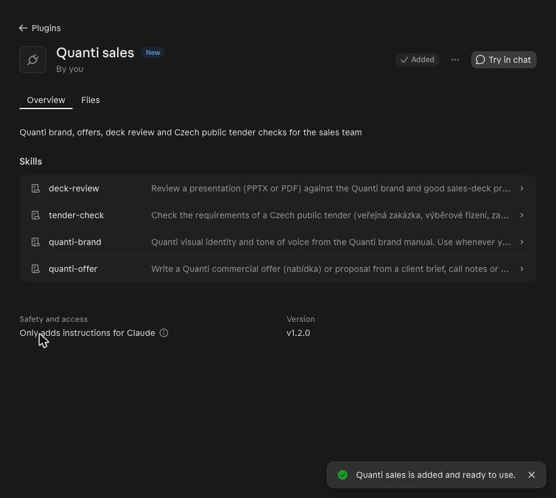
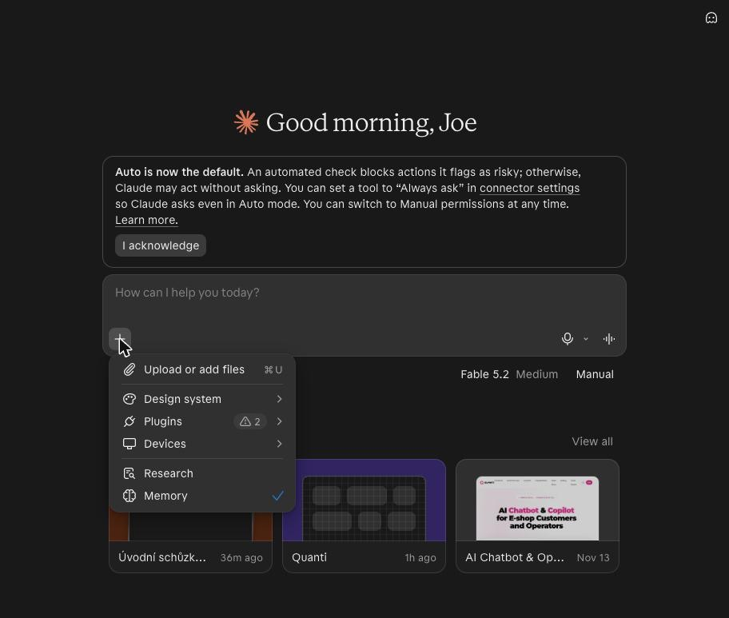
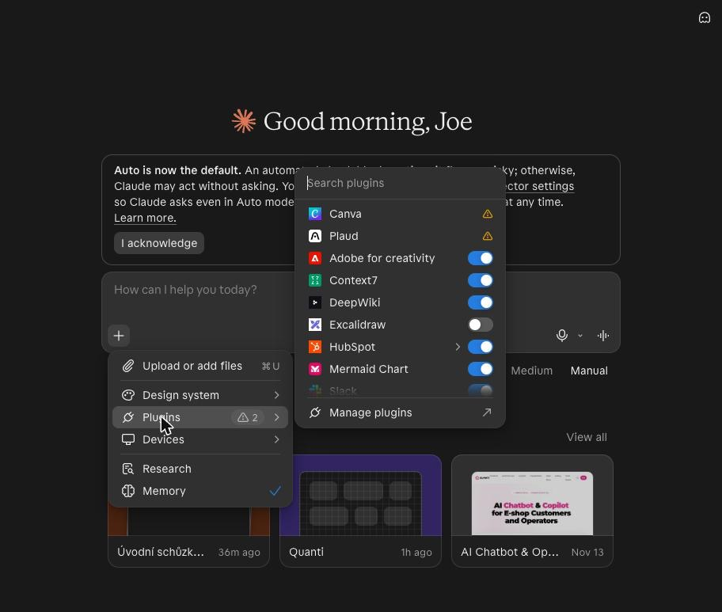
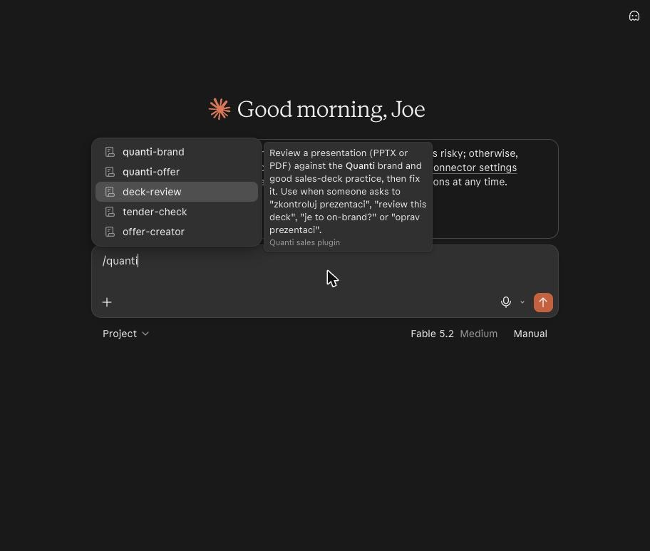
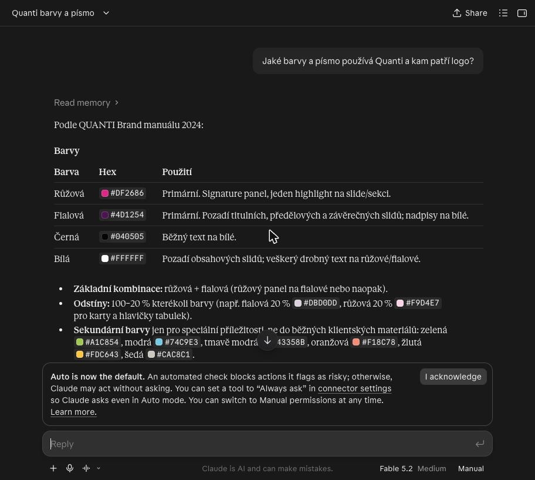

> 🌍 Read this in: **English** | [Česky](01-setup.cs.md)

# 01 · Setup, step by step

The screenshots are from claude.ai in a browser; the Claude desktop app shows the same screens.
Where the desktop app differs, the step says so.

## Exercise 0, step 0 · Before the first prompt (everyone, 10 min)

Nothing is done in advance; all of this happens at the start of the workshop.

1. **Open the Claude desktop app** (install it from [claude.com/download](https://claude.com/download)
   if you don't have it) and sign in with your Quanti account. The window must show your name
   at the bottom left.
2. **Install Montserrat**: in Finder open `~/Documents/qti-cowork-sales/sample-data/brand/fonts/`,
   select the four `Montserrat-*.ttf` files, double-click → **Install**. Without it PowerPoint
   and Word show the decks in another font.
3. **Unzip the workshop package** you received (`qti-cowork-sales.zip`) so that the folder
   `~/Documents/qti-cowork-sales/sample-data` exists.
4. **Get the plugin file ready**: `~/Documents/qti-cowork-sales/dist/quanti-sales.zip`. You
   upload it yourself in step 1 below; nobody installs it for you.
5. **Connect HubSpot**: Claude → **Plugins** → search "HubSpot" → **Connect** → sign in with your
   HubSpot login and allow access. Back in Plugins, HubSpot must show without a "Sign-in
   expired" badge.
6. **Pick a deal**: one open deal of yours in HubSpot with at least one logged e-mail or call.
   Write down its name; you need it in exercise 9.
7. Have PowerPoint, Word and Excel (or Keynote, Pages, Numbers) ready.

## Exercise 0, steps 1–3 (10 min)

### Step 1 · Upload the plugin (everyone)

1. Left sidebar → **Plugins**.
2. Top right → **Add** → **Upload plugin**.

   

3. Click **browse**, pick `~/Documents/qti-cowork-sales/dist/quanti-sales.zip`. The preview must
   read **quanti-sales** with the description "Quanti brand, decks on the official template…".

   

4. Click **Upload**. You land on the plugin page: **Quanti sales · Added**, version 1.3.0 and
   five skills: `deck-review`, `tender-check`, `quanti-brand`, `quanti-offer`, `deal-brief`.

   

   If the page shows four skills or version 1.2.0, the old plugin is still installed: on the
   Plugins page open the **…** menu next to Quanti sales → **Remove**, then upload again.

### Step 2 · Start a conversation with the working folder

1. Left sidebar → **New**. In the desktop app the new conversation opens in **Cowork** mode
   (the icon with the folder, top of the sidebar); on claude.ai choose the **Claude** tab.
2. Click **+** at the bottom left of the message box.

   

3. Desktop app: choose the folder `~/Documents/qti-cowork-sales/sample-data` when asked which
   folder Claude may work in. Browser: **Devices → your Mac** first, then the folder. Claude
   writes every output into this folder, next to the inputs.
4. Check **Plugins** in the same + menu: **Quanti sales** must be switched on (toggle to the
   right). HubSpot too, for exercise 9.

   

> Work on copies. Claude can overwrite files in the folder you give it. For real client work,
> give it a project folder, never your whole Documents.

### Step 3 · Smoke test

1. In the message box type `/` and then `quanti`. The menu lists the plugin's skills. Press
   **Escape** (you only wanted to see them).

   

2. Paste and send:

   ```
   Jaké barvy a písmo používá Quanti a kam patří logo?
   ```

3. The answer must contain `#DF2686`, `#4D1254`, **Montserrat** (Arial as the system font)
   and "logo vždy v pravém dolním rohu".

   

## If it goes wrong

| What you see | Why | Do this |
|---|---|---|
| Generic answer about brands | Plugin off or not installed | + → Plugins → switch Quanti sales on; or start the prompt with "Použij skill quanti-brand." |
| "Upload" button stays grey | No file chosen, or wrong file type | Choose the `.zip` from `dist/`, not the folder |
| Claude asks for a folder again | Each new conversation starts without a folder | Give `sample-data` again (step 2) |
| Decks open in Arial/Calibri | Montserrat not installed on this Mac | Step 0.2 |
| HubSpot shows "Sign-in expired" | Token expired | Plugins → HubSpot → **Reconnect** |

## How it works

When you send a message, Claude sees the **descriptions** of every installed skill. The
`quanti-brand` description says "use whenever you create anything a client will see", so it is
loaded for decks and offers even when you never name it. Naming the skill (`/quanti-brand` or
"Použij skill quanti-brand") is more reliable in the workshop.
