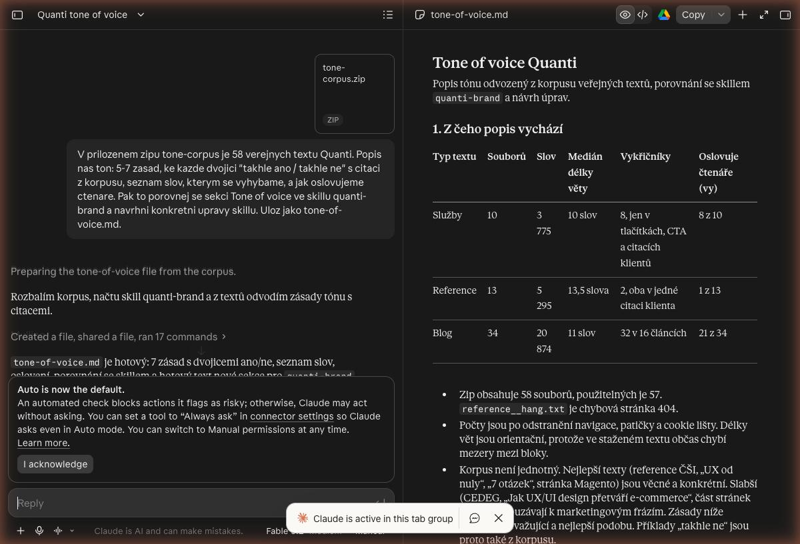
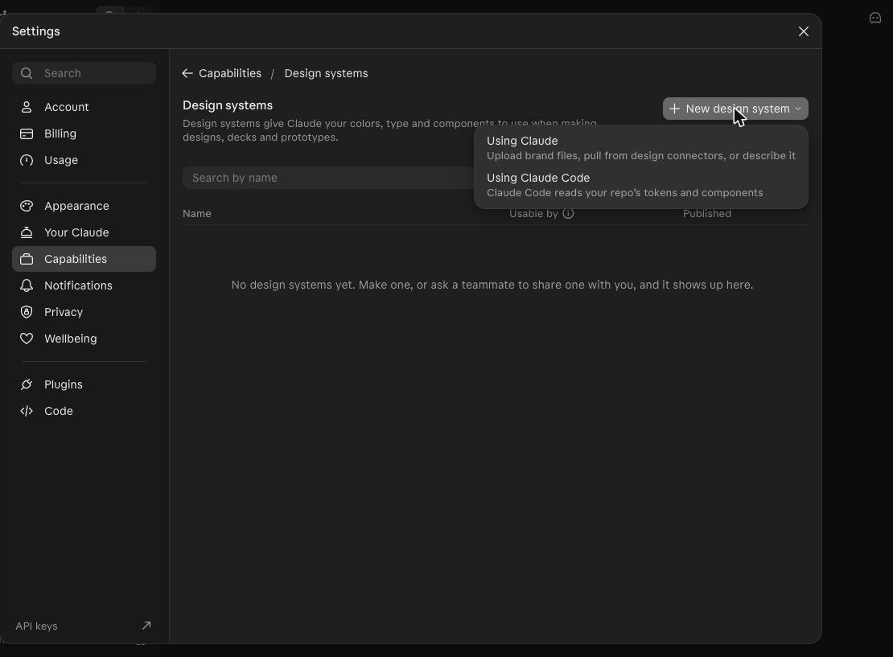
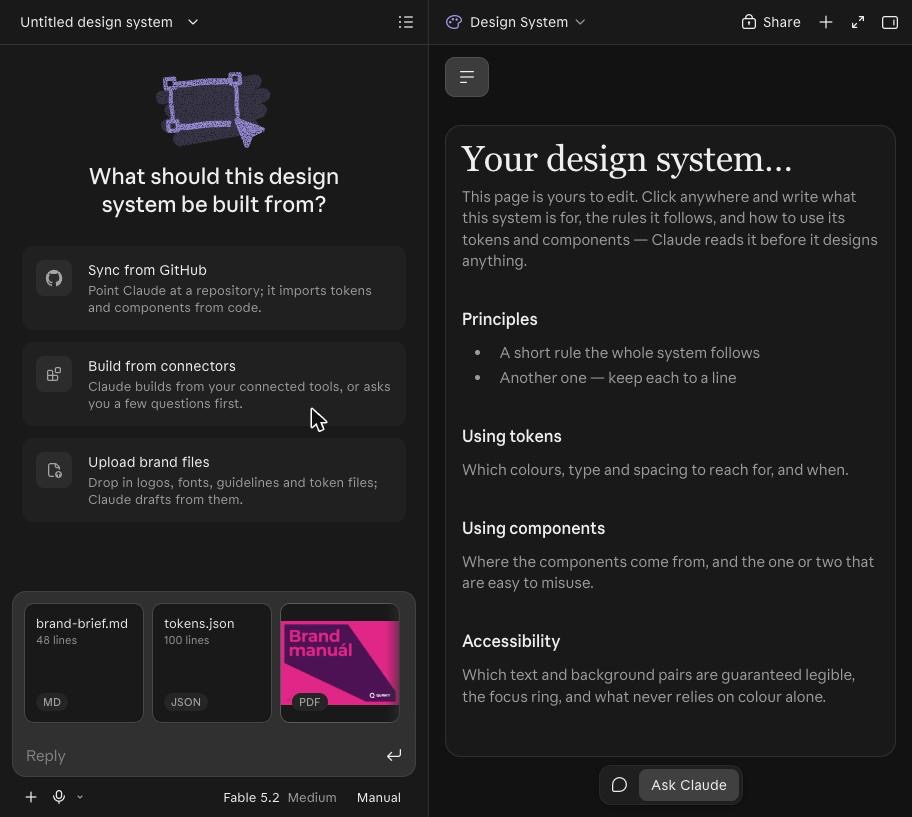
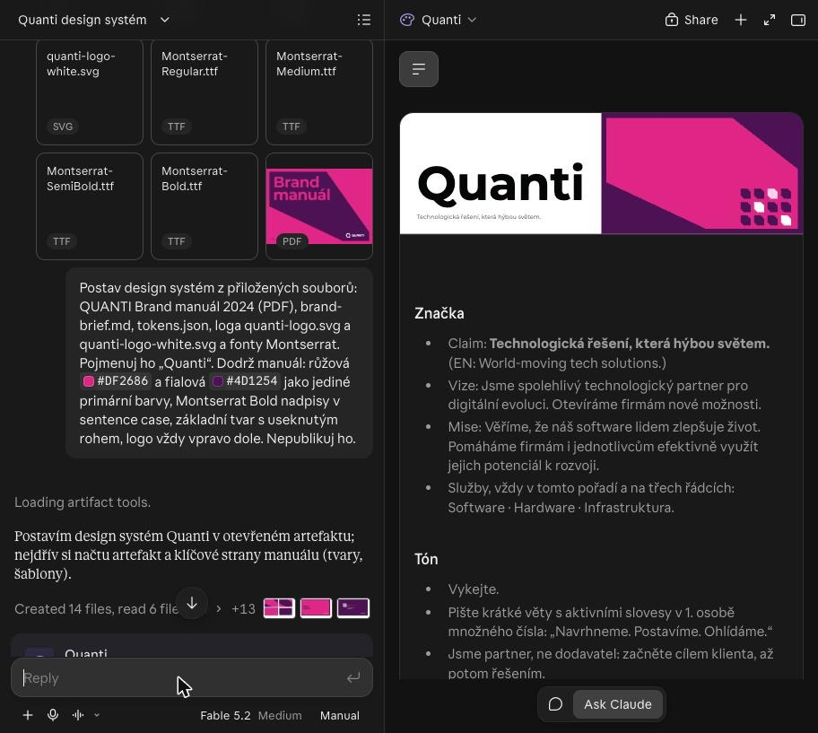
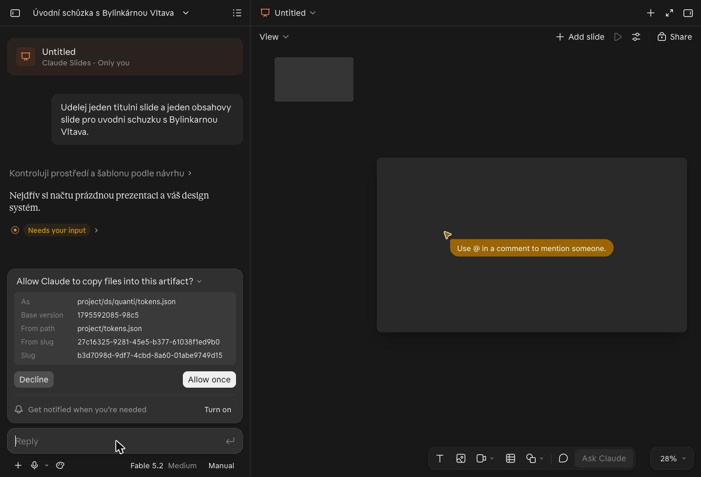
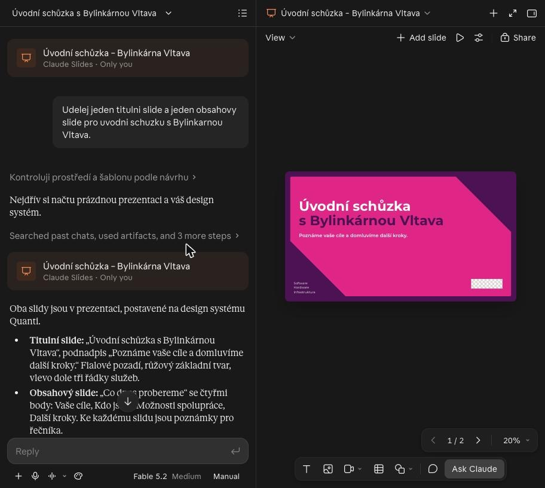
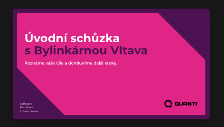
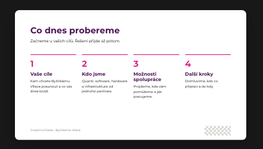

> 🌍 Read this in: [English](02-brand.md) | **Česky**

# 02 · Brand: tón a vizuální identita krok za krokem

## Cvičení 1 · Tón ze skutečných textů (20 min)

1. **New** konverzace, složka `sample-data` (01-setup, krok 2).
2. Vložte a odešlete:

   ```
   Ve složce tone-corpus/ je 58 veřejných textů Quanti. Popiš náš tón: 5–7 zásad, ke každé
   dvojici „takhle ano / takhle ne“ s citací z korpusu, seznam slov, kterým se vyhýbáme, a jak
   oslovujeme čtenáře. Pak to porovnej se sekcí Tone of voice ve skillu quanti-brand a navrhni
   konkrétní úpravy skillu. Ulož jako brand/tone-of-voice.md.
   ```

3. Počkejte 2–4 minuty. Claude přečte soubory, spočítá slova a délky vět a napíše
   `brand/tone-of-voice.md`. Otevřete ho z karty souboru v chatu nebo ze složky.
4. Kontrola: každá zásada má skutečnou citaci (jednu si v korpusu vyhledejte); je tu seznam
   konkrétních úprav skillu, ne „vypadá dobře“.

   

5. Volitelně: s nainstalovaným pluginem `brand-voice` napište `/brand-voice:generate-guidelines`
   nad stejnou složkou a porovnejte.

## Cvičení 2 · Design systém z brand podkladů (20 min)

### Část A · Založení design systému

1. Vlevo dole → vaše jméno → **Settings** → **Capabilities** → **Design systems** → **Manage**.
2. Vpravo nahoře → **New design system** → **Using Claude**.

   

3. Otevře se chat vedle prázdné stránky design systému. Klikněte na **Upload brand files** (nebo
   **+** → **Upload or add files**) a vyberte ze `sample-data/brand/`: `QUANTI_Brand_Manual_2024.pdf`,
   `brand-brief.md`, `tokens.json`, `quanti-logo.svg`, `quanti-logo-white.svg`, čtyři
   `fonts/Montserrat-*.ttf` a `templates/Quanti_PPT_Template_CZ.potx`.

   

4. Vložte a odešlete:

   ```
   Postav design systém z přiložených souborů. Pojmenuj ho „Quanti“. Dodrž manuál: růžová #DF2686
   a fialová #4D1254 jako jediné primární barvy, Montserrat Bold nadpisy v sentence case, základní
   tvar s useknutým rohem, logo vždy vpravo dole. Nepublikuj ho.
   ```

5. Počkejte asi 5 minut. Stránka vpravo se naplní: barvy, písmo, základní tvar, komponenty
   slidů, brand book. V hlavičce musí být **Quanti · Design System · Only you**. *Only you*
   znamená nepublikovaný, což chceme.

   

6. Porovnejte náhled s briefem: nadpisy bez verzálek, panel se seříznutými rohy (ne zaoblené
   karty), logo vpravo dole. Když něco nesedí, napište to do chatu; Claude stránku upraví.

### Část B · Použití ve Slides

1. Levý panel → **Design** → dlaždice **Slides**.
2. Pod polem pro zprávu klikněte na **Choose design system…** → **Quanti**.
3. Vložte a odešlete:

   ```
   Udělej jeden titulní slide a jeden obsahový slide pro úvodní schůzku s Bylinkárnou Vltava.
   ```

4. Pokud je konverzace v režimu oprávnění *Manual*, Claude se zeptá **Allow Claude to copy files
   into this artifact?** (tokeny design systému). Klikněte na **Allow once**.

   

5. Asi po minutě se vpravo objeví oba slidy.

   

6. Pokud je místo loga prázdné místo: **+** → **Upload or add files** →
   `brand/quanti-logo-white.svg` a pošlete:

   ```
   Vlož přiložené bílé logo vpravo dole místo zástupného místa.
   ```

7. Kontrola: fialové pozadí, růžový panel se seříznutými rohy, nadpis Montserrat Bold bez
   verzálek, bílé logo vpravo dole; obsahový slide bílý s fialovým nadpisem.

   
   

## Když něco nejde

| Co vidíte | Proč | Udělejte |
|---|---|---|
| V Capabilities nejsou „Design systems“ | Plán Enterprise: musí je zapnout admin (Organization settings → Artifacts) | Řekněte adminovi; část B udělejte skillem `quanti-brand` v Cowork |
| Výběr design systému je prázdný | Založený pod jiným účtem nebo neuložený | Část A znovu, zkontrolujte hlavičku artefaktu Quanti |
| Slides stojí na „Needs your input“ | Režim oprávnění Manual | Klikněte na **Allow once** (krok B4) |
| Nadpisy verzálkami, zaoblené karty | Typické chyby prvního běhu | Napište to do chatu design systému; Claude stránku opraví |

## Pozadí: kde v Claude žije brand

| Kde | Co obsahuje | Kdo nastavuje | Používá |
|---|---|---|---|
| Skill `quanti-brand` (plugin) | Barvy, písmo, pravidla loga, oficiální šablona PPT, intro prezentace, tón, pravidlo pro tvrzení, závěrečná kontrola | Vedoucí obchodu, jednou; v pluginu | Každý soubor, který Claude v Cowork napíše: PPTX, DOCX, XLSX, PDF |
| **Design systém** (Settings → Capabilities → Design systems) | Vizuální styly vytažené z podkladů | Kdo vlastní brand; *Published* z něj udělá výchozí pro organizaci | Claude Slides, Claude Design a HTML artefakty |
| Soubory projektu nebo konverzace | Brand brief, loga, korpus textů | Kdokoli | Jen ten projekt nebo konverzaci |

Skill cestuje s každým úkolem; design systém dává vizuálním nástrojům start v brandu. Oba
držte v souladu z jednoho zdroje, `sample-data/brand/tokens.json`.

**Pravidlo pro tvrzení.** Největší riziko brandu v obchodu je číslo, které nikdo nedoloží. Skill
povoluje čísla, klienty a certifikáty jen ze vstupů úkolu, z intro prezentace nebo
z `approved-claims.md`, jinak píše `[DOPLNIT: …]`. Ty značky čekejte; jsou záměr.

> Samostatný Claude Design (claude.ai/design) končí **14. 12. 2026**. Design systémy zůstávají
> v Settings → Capabilities → Design systems.
