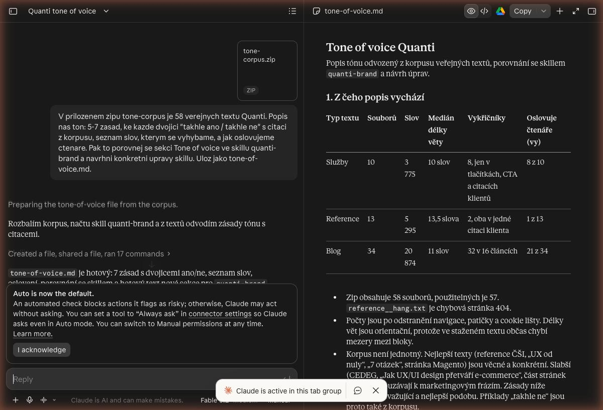
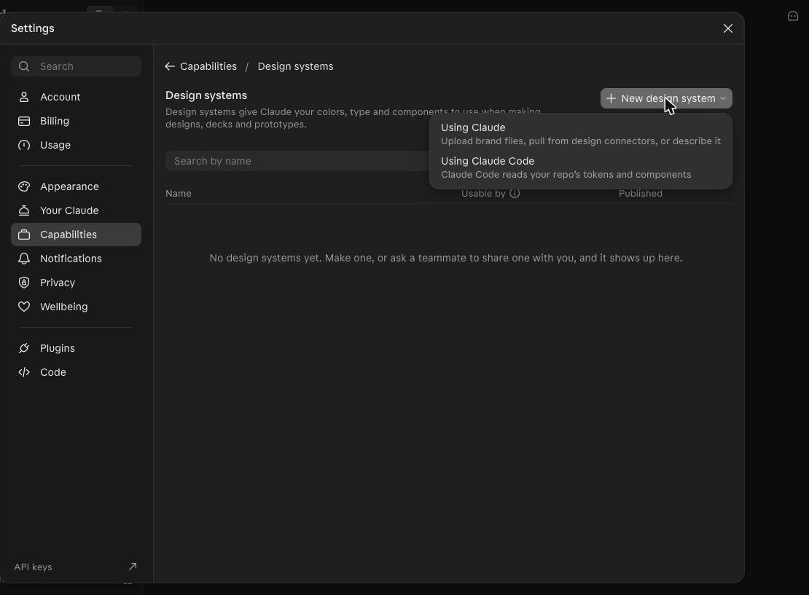
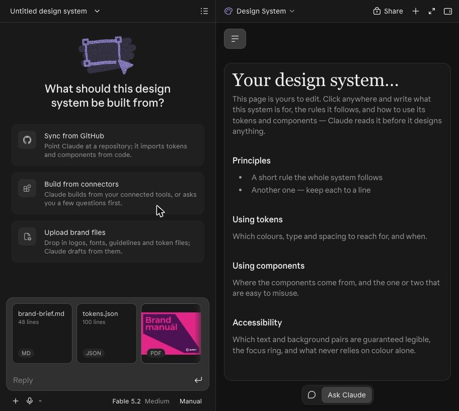
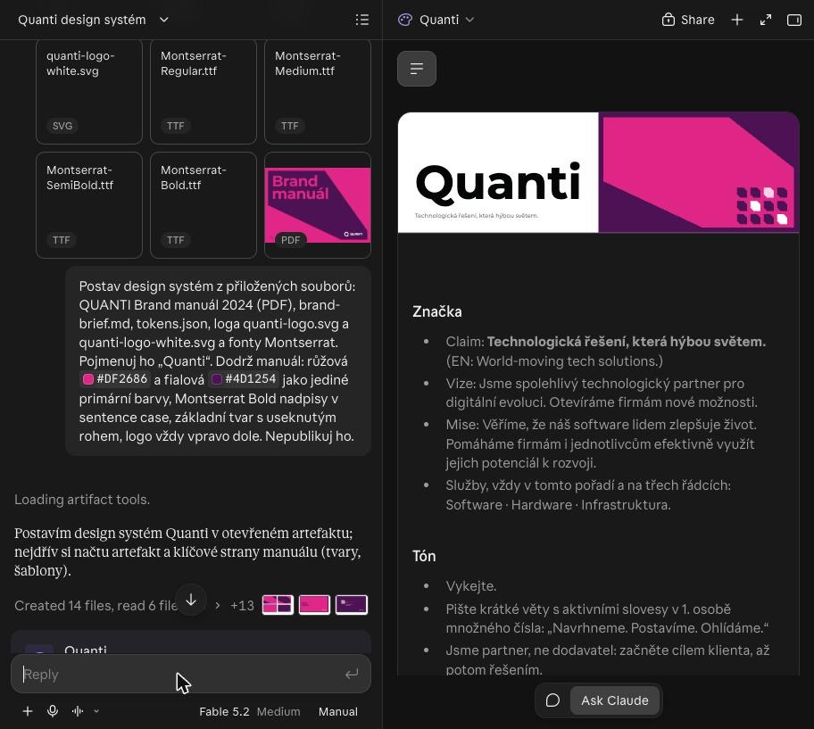
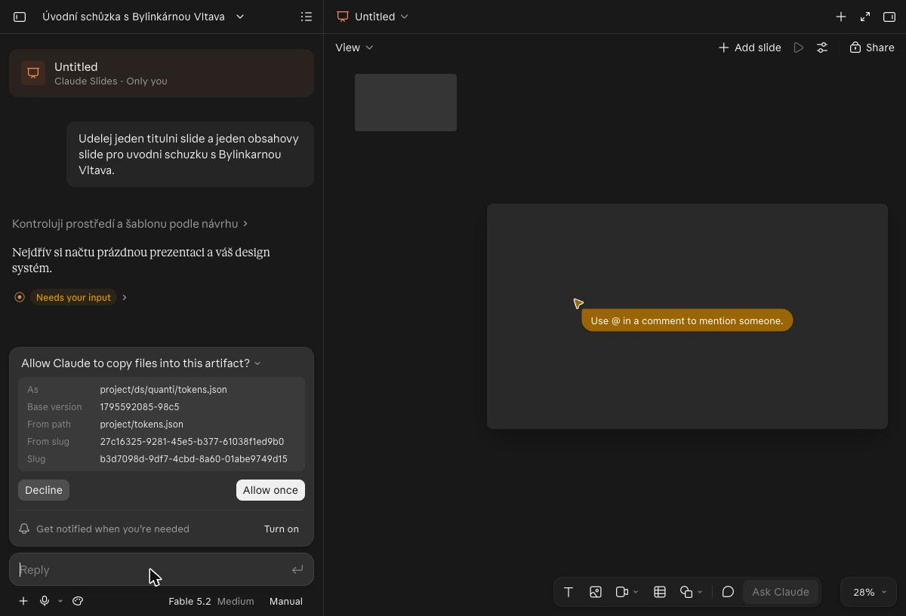
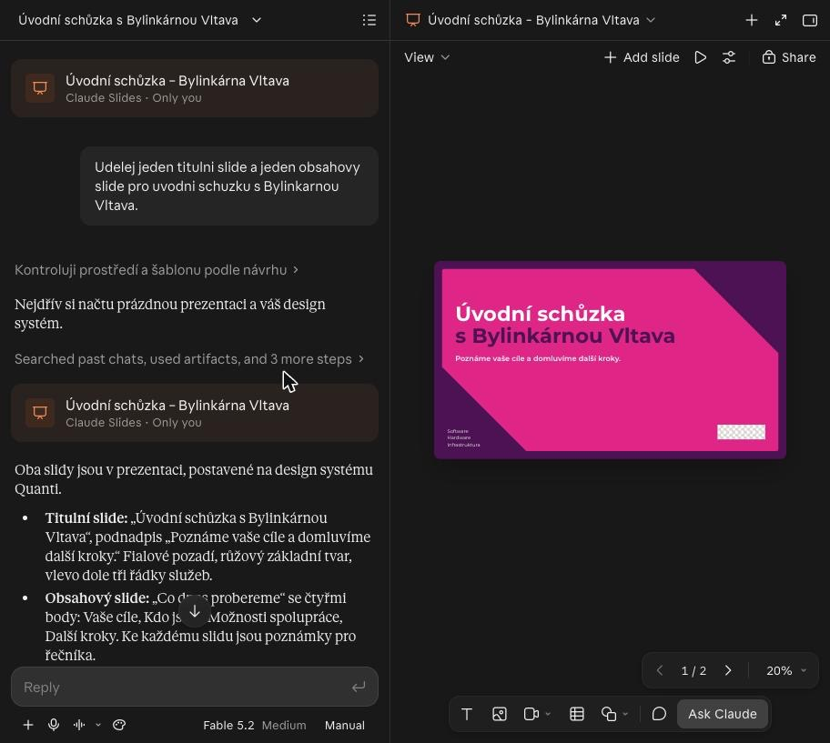
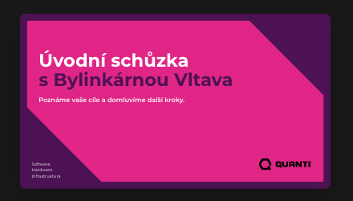
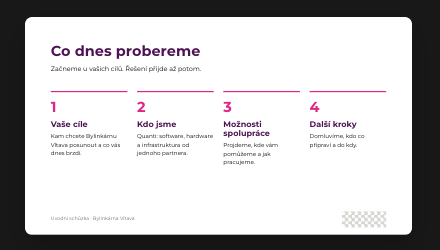

> 🌍 Read this in: **English** | [Česky](02-brand.cs.md)

# 02 · Brand: voice and visual identity, step by step

## Exercise 1 · Tone of voice from real texts (20 min)

1. **New** conversation, folder `sample-data` (01-setup, step 2).
2. Paste and send:

   ```
   Ve složce tone-corpus/ je 58 veřejných textů Quanti. Popiš náš tón: 5–7 zásad, ke každé
   dvojici „takhle ano / takhle ne“ s citací z korpusu, seznam slov, kterým se vyhýbáme, a jak
   oslovujeme čtenáře. Pak to porovnej se sekcí Tone of voice ve skillu quanti-brand a navrhni
   konkrétní úpravy skillu. Ulož jako brand/tone-of-voice.md.
   ```

3. Wait 2–4 minutes. Claude reads the files, counts words and sentence lengths, and writes
   `brand/tone-of-voice.md`. Open it from the file card in the chat or from the folder.
4. Check: every principle has a real quote (pick one and search the corpus for it); there is a
   list of concrete edits to the skill, not "looks good".

   

5. Optional: with the `brand-voice` plugin installed, type `/brand-voice:generate-guidelines`
   on the same folder and compare.

## Exercise 2 · A design system from brand assets (20 min)

### Part A · Create the design system

1. Bottom left → your name → **Settings** → **Capabilities** → **Design systems** → **Manage**.
2. Top right → **New design system** → **Using Claude**.

   

3. A chat opens next to an empty design-system page. Click **Upload brand files** (or **+** →
   **Upload or add files**) and pick from `sample-data/brand/`: `QUANTI_Brand_Manual_2024.pdf`,
   `brand-brief.md`, `tokens.json`, `quanti-logo.svg`, `quanti-logo-white.svg`, the four
   `fonts/Montserrat-*.ttf` and `templates/Quanti_PPT_Template_CZ.potx`.

   

4. Paste and send:

   ```
   Postav design systém z přiložených souborů. Pojmenuj ho „Quanti“. Dodrž manuál: růžová #DF2686
   a fialová #4D1254 jako jediné primární barvy, Montserrat Bold nadpisy v sentence case, základní
   tvar s useknutým rohem, logo vždy vpravo dole. Nepublikuj ho.
   ```

5. Wait about 5 minutes. The page on the right fills in: colours, type, the basic shape, slide
   components, the brand book. The header must read **Quanti · Design System · Only you**.
   *Only you* means unpublished, which is what we want.

   

6. Check the preview against the brief: sentence-case headings, cut-corner panel (not rounded
   cards), logo bottom-right. If something is off, say so in the chat; Claude edits the page.

### Part B · Use it in Slides

1. Left sidebar → **Design** → tile **Slides**.
2. Under the message box click **Choose design system…** → **Quanti**.
3. Paste and send:

   ```
   Udělej jeden titulní slide a jeden obsahový slide pro úvodní schůzku s Bylinkárnou Vltava.
   ```

4. If the conversation is in *Manual* permission mode, Claude asks **Allow Claude to copy files
   into this artifact?** (the design system's tokens). Click **Allow once**.

   

5. After about a minute the two slides appear on the right.

   

6. If the logo is an empty placeholder: **+** → **Upload or add files** →
   `brand/quanti-logo-white.svg`, then send:

   ```
   Vlož přiložené bílé logo vpravo dole místo zástupného místa.
   ```

7. Check: purple background, pink cut-corner panel, Montserrat Bold sentence-case title, white
   logo bottom-right; the content slide white with purple heading.

   
   

## If it goes wrong

| What you see | Why | Do this |
|---|---|---|
| No "Design systems" under Capabilities | Enterprise plan: an admin must enable them (Organization settings → Artifacts) | Ask the admin; do part B with the `quanti-brand` skill in Cowork instead |
| The design system picker is empty | Created under another account, or not saved | Part A again, check the artifact header says Quanti |
| Slides stop at "Needs your input" | Manual permission mode | Click **Allow once** (step B4) |
| Uppercase headings, rounded cards | First-run misses | Tell Claude in the design-system chat; it fixes the page |

## Background: where brand lives in Claude

| Where | What it holds | Who sets it up | Used by |
|---|---|---|---|
| Skill `quanti-brand` (plugin) | Colours, type, logo rules, the official PPT template, the intro deck, tone, claims policy, a final checklist | Sales lead, once; shipped in the plugin | Every file Claude writes in Cowork: PPTX, DOCX, XLSX, PDF |
| **Design system** (Settings → Capabilities → Design systems) | Visual styles extracted from your assets | Whoever owns the brand; *Published* makes it the org default | Claude Slides, Claude Design and HTML artifacts |
| Project or conversation files | Brand brief, logos, tone corpus | Anyone | Only that project or conversation |

The skill travels with every task; the design system makes the visual tools start on-brand.
Keep both in sync from one source, `sample-data/brand/tokens.json`.

**The claims rule.** The biggest brand risk in sales is a number nobody can back. The skill
allows numbers, clients and certificates only from the task's inputs, the intro deck or
`approved-claims.md`, and writes `[DOPLNIT: …]` otherwise. Expect those markers; they are the
feature.

> Standalone Claude Design (claude.ai/design) closes on **14 Dec 2026**. Design systems stay
> under Settings → Capabilities → Design systems.
