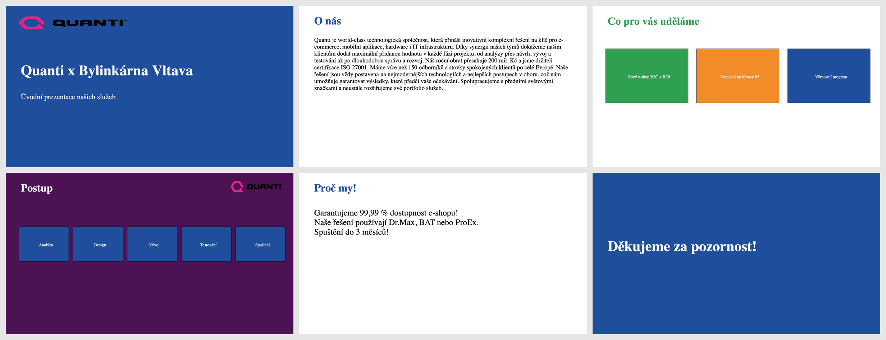
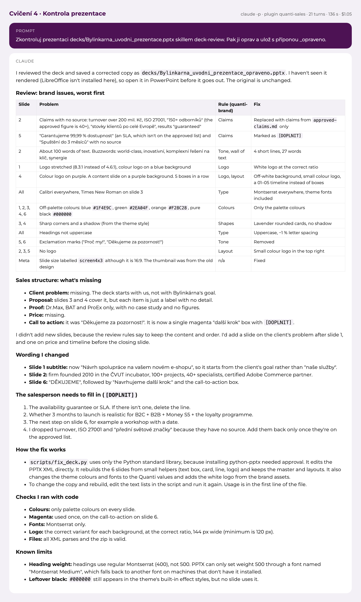
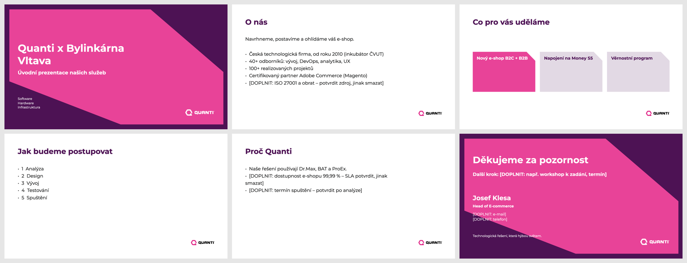

> 🌍 Read this in: [English](03-decks.md) | **Česky**

# 03 · Prezentace krok za krokem

Dva soubory, které je dobré znát, než začnete:

| Soubor | Co to je | Pravidlo |
|---|---|---|
| `brand/templates/Quanti_PPT_Template_CZ.potx` (+ `_ENG`) | Oficiální šablona: 26 rozvržení, 46 ukázkových slidů s grafy, Gantty, časovými osami, organigramy, tabulkami, ikonami | Každá prezentace začíná tady; ukázkové slidy se duplikují, ne kreslí znovu |
| `decks/Quanti_intro_2026_CZ.pptx` | Schválená firemní prezentace: fakta, služby, certifikace, 30 referencí, pobočky | Firemní slidy se z ní kopírují; čísla jen odsud nebo z `approved-claims.md` |

## Cvičení 3 · Prezentace z poptávky (25 min)

1. **New** konverzace, složka `sample-data`.
2. Vložte a odešlete (spusťte to jako první, čtěte dál, než běží: trvá to 8–12 minut):

   ```
   Použij skill quanti-brand. Z podkladu offer/client-brief.md připrav úvodní prezentaci Quanti
   pro Bylinkárnu Vltava na oficiální šabloně: 8 slidů, 16:9, PPTX. Struktura: titulní slide, jak
   rozumíme vaší situaci, co navrhujeme, jak bychom postupovali (časová osa), proč Quanti (slidy
   z intro prezentace decks/Quanti_intro_2026_CZ.pptx, jen schválená tvrzení), 2 reference
   z retailu, další krok, závěrečný slide. Ulož jako Bylinkarna_uvod.pptx a na konci vypiš, co
   jsi zkontroloval.
   ```

3. Co Claude dělá (vidíte v seznamu aktivit): přečte poptávku a skill, zkopíruje šablonu,
   zduplikuje rozvržení a ukázkový Gantt, zkopíruje „Kdo jsme“ z intro prezentace, napíše texty,
   zvaliduje soubor, vypíše, co zkontroloval.
4. Otevřete `Bylinkarna_uvod.pptx` v PowerPointu. Kontrola:
   - 8 slidů na rozvrženích Quanti Theme (Intro, Title and Content, Jenom nadpis s časovou
     osou, Outro); Montserrat; tučné nadpisy bez verzálek; jen růžová, fialová, černá, bílá
     a jejich odstíny;
   - logo vpravo dole na každém slidu; nikde ukázkový text („Text“, „Insert text here“);
   - slide 2 cituje poptávku (14 prodejen, Money S5, 30. 9. 2027);
   - „Proč Quanti“ je slide z intro prezentace; co nemá zdroj, je `[DOPLNIT]`;
   - poslední obsahový slide má jeden konkrétní další krok.

   

## Cvičení 4 · Kontrola a oprava prezentace mimo brand (20 min)

1. **New** konverzace, složka `sample-data`.
2. Vložte a odešlete:

   ```
   Zkontroluj prezentaci decks/Bylinkarna_uvodni_prezentace.pptx skillem deck-review.
   ```

3. Přečtěte tabulku zprávy (slide, problém, pravidlo, oprava). Dobrá kontrola najde aspoň 12
   z nastražených chyb: modré pozadí, Calibri a Times, roztažené barevné logo na fialové, slide
   se 110 slovy, prázdné fráze, neschválená tvrzení (200 mil. Kč, ISO 27001, 150+ expertů), pět
   boxů v řadě, „Proč my!“, chybějící další krok.

   
   

4. Pak pošlete:

   ```
   Oprav ji podle zprávy a ulož s příponou _opraveno.
   ```

5. Otevřete `Bylinkarna_uvodni_prezentace_opraveno.pptx`: postavená znovu na oficiální šabloně,
   bez modré, zelené, oranžové, Calibri i Times; tvrzení odstraněná nebo `[DOPLNIT]`; obsah
   a pořadí zachované.

   

## Když něco nejde

| Co vidíte | Proč | Udělejte |
|---|---|---|
| Prezentace ve výchozím motivu Office, bez seříznutých rohů | Skill se nenačetl | Začněte prompt „Použij skill quanti-brand“ |
| Nadpisy patkovým písmem v Quick Looku | Quick Look neumí Montserrat SemiBold/ExtraBold | Otevřete v PowerPointu s nainstalovaným Montserratem |
| Claude nemohl slidy vyrenderovat | V sandboxu není LibreOffice | Normální; soubor si otevřete sami |
| Trvá to dlouho | Cesta přes šablonu = rozbalit, duplikovat, validovat | Počítejte s 8–12 min; spusťte dřív, než vysvětlujete |

## Pozadí

Claude staví prezentaci vestavěným skillem `pptx` v režimu „šablona“: zkopíruje `.potx`,
zduplikuje potřebná rozvržení a ukázkové slidy, ostatní smaže, upraví XML slidů tak, aby
zástupné rámečky zachovaly písma a velikosti, zkopíruje firemní slidy z intro prezentace
a zvaliduje soubor proti šabloně. `deck-review` čte samotný soubor, ne jeho obrázek: vypíše
barvy a písma každého tvaru a pak zkontroluje obchodní strukturu (problém, návrh, důkaz, další
krok).

Obchodní struktura na první schůzku: titulní → situace klienta jeho slovy → co navrhujeme (tři
výsledky) → jak bychom postupovali (fáze a jedno datum, na kterém záleží) → proč Quanti (slidy
z intro prezentace, 2–3 reference) → další krok → závěr s vaším kontaktem.
