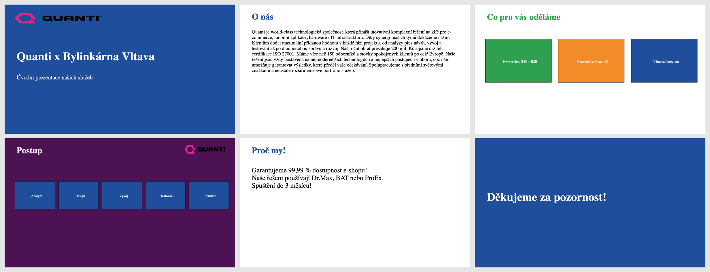
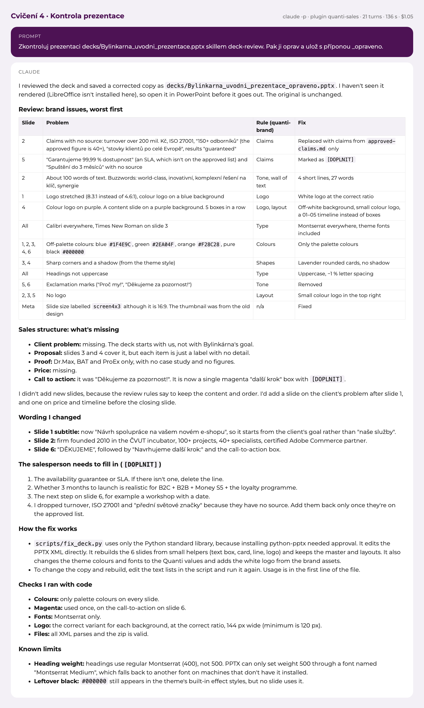
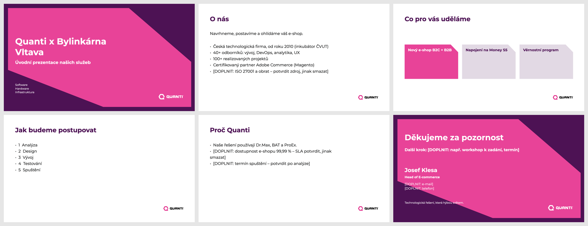

> 🌍 Read this in: **English** | [Česky](03-decks.cs.md)

# 03 · Presentations, step by step

Two files to know before you start:

| File | What it is | Rule |
|---|---|---|
| `brand/templates/Quanti_PPT_Template_CZ.potx` (+ `_ENG`) | The official template: 26 layouts, 46 sample slides with charts, Gantt charts, timelines, organisation diagrams, tables, icons | Every deck starts here; sample slides are duplicated, not redrawn |
| `decks/Quanti_intro_2026_CZ.pptx` | The approved company presentation: facts, services, certifications, 30 references, offices | Company slides are copied from it; numbers only from here or `approved-claims.md` |

## Exercise 3 · A deck from a brief (25 min)

1. **New** conversation, folder `sample-data`.
2. Paste and send (start it first, read on while it runs: it takes 8–12 minutes):

   ```
   Použij skill quanti-brand. Z podkladu offer/client-brief.md připrav úvodní prezentaci Quanti
   pro Bylinkárnu Vltava na oficiální šabloně: 8 slidů, 16:9, PPTX. Struktura: titulní slide, jak
   rozumíme vaší situaci, co navrhujeme, jak bychom postupovali (časová osa), proč Quanti (slidy
   z intro prezentace decks/Quanti_intro_2026_CZ.pptx, jen schválená tvrzení), 2 reference
   z retailu, další krok, závěrečný slide. Ulož jako Bylinkarna_uvod.pptx a na konci vypiš, co
   jsi zkontroloval.
   ```

3. What Claude does, visible in the activity list: reads the brief and the skill, copies the
   template, duplicates the layouts and the Gantt sample slide, copies "Kdo jsme" from the intro
   deck, writes the texts, validates the file, lists what it checked.
4. Open `Bylinkarna_uvod.pptx` in PowerPoint. Check:
   - 8 slides on the Quanti Theme layouts (Intro, Title and Content, Jenom nadpis with a
     timeline, Outro); Montserrat; bold sentence-case headings; only pink, purple, black, white
     and their tints.
   - Logo bottom-right on every slide. No sample text ("Text", "Insert text here").
   - Slide 2 quotes the brief (14 prodejen, Money S5, 30. 9. 2027).
   - "Proč Quanti" is the intro deck's slide; anything unsourced is `[DOPLNIT]`.
   - The last content slide has one concrete next step.

   

## Exercise 4 · Review and fix an off-brand deck (20 min)

1. **New** conversation, folder `sample-data`.
2. Paste and send:

   ```
   Zkontroluj prezentaci decks/Bylinkarna_uvodni_prezentace.pptx skillem deck-review.
   ```

3. Read the report table (slide, problem, rule, fix). A good review finds at least 12 of the
   planted errors: blue background, Calibri and Times, stretched colour logo on purple, a
   110-word slide, buzzwords, the unapproved claims (200 mil. Kč, ISO 27001, 150+ experts),
   five boxes in a row, "Proč my!", no next step.

   
   

4. Then send:

   ```
   Oprav ji podle zprávy a ulož s příponou _opraveno.
   ```

5. Open `Bylinkarna_uvodni_prezentace_opraveno.pptx`: rebuilt on the official template, no
   blue, green, orange, Calibri or Times; claims removed or `[DOPLNIT]`; content and order kept.

   

## If it goes wrong

| What you see | Why | Do this |
|---|---|---|
| Deck in Office's default theme, no cut corners | Skill not loaded | Start the prompt with "Použij skill quanti-brand" |
| Headings in a serif font in Quick Look | Quick Look cannot render Montserrat SemiBold/ExtraBold | Open in PowerPoint with Montserrat installed |
| Claude could not render slides | No LibreOffice in the sandbox | Normal; open the file yourself |
| It takes long | Template route = unpack, duplicate, validate | Expected 8–12 min; start it before explaining |

## Background

Claude builds the deck with the built-in `pptx` skill in "template" mode: copy the `.potx`,
duplicate the layouts and sample slides it needs, delete the rest, edit the slide XML so that
placeholders keep their fonts and sizes, copy company slides from the intro deck, validate
against the template. `deck-review` reads the file itself, not a picture of it: it lists the
colours and fonts in every shape, then checks the sales structure (problem, proposal, proof,
next step).

The sales structure for a first meeting: title → the client's situation in their words → what
we propose (three outcomes) → how we would do it (phases and the one date that matters) → why
Quanti (intro-deck slides, 2–3 references) → next step → closing with your contact.
