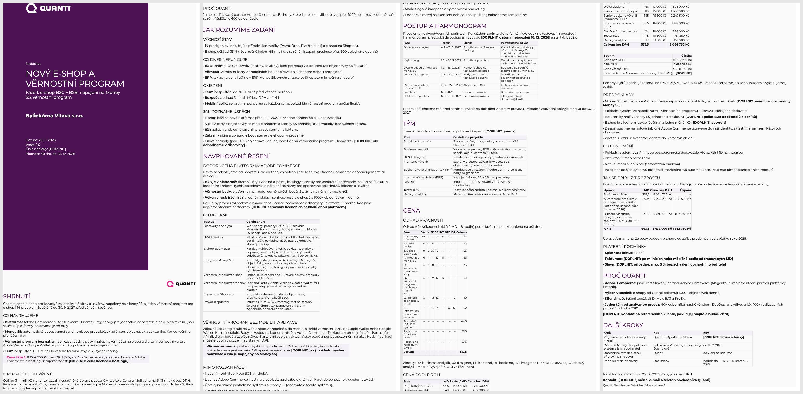
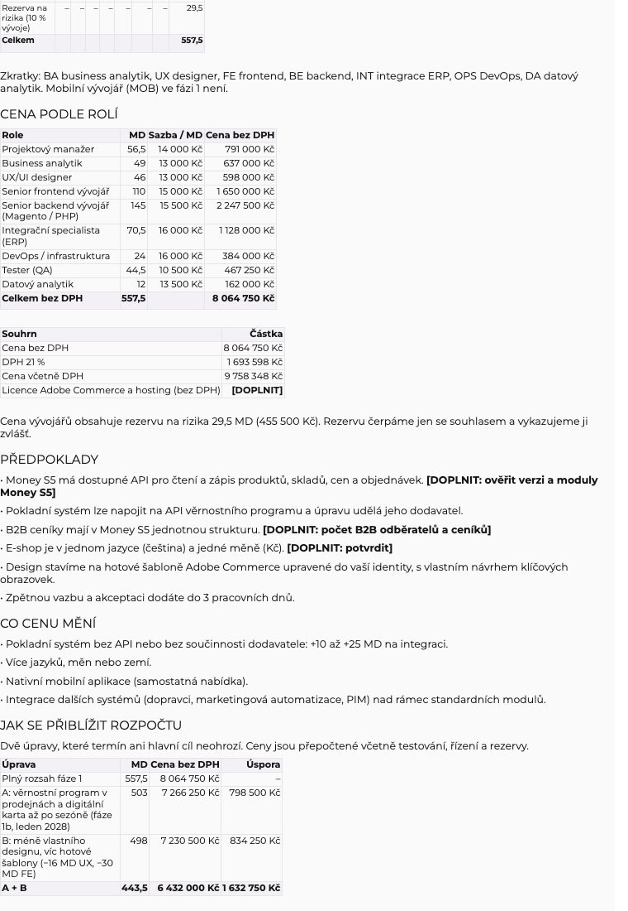

> 🌍 Read this in: [English](04-offers.md) | **Česky**

# 04 · Nabídky krok za krokem

## Cvičení 5 · Naceněná nabídka (35 min)

1. **New** konverzace, složka `sample-data`.
2. Vložte a odešlete:

   ```
   Skillem quanti-offer připrav nabídku pro Bylinkárnu Vltava podle offer/client-brief.md a ceníku
   offer/rate-card.xlsx (dodržuj pravidla na listu Pravidla). První fáze: e-shop B2C + B2B
   napojený na Money S5 a věrnostní program bez nativní mobilní aplikace; platformu doporuč.
   Výstup DOCX.
   ```

3. Když se Claude ptá (rozpočet, termín, rozsah), odpovídejte z poptávky: 3–4 mil. Kč bez DPH,
   30. 9. 2027. Asi 4–6 minut.
4. Otevřete DOCX ve Wordu. Kontrola:
   - sekce v tomto pořadí: shrnutí, porozumění, řešení, plán, tým, cena, proč Quanti, další
     kroky; fialová obálka s růžovým panelem a bílým logem;
   - cenová tabulka ukazuje MD × sazba podle rolí, PM = 12 % a QA = 15 % ze správného základu,
     součty bez DPH, DPH 21 %, s DPH: **jeden řádek si přepočítejte sami**;
   - licence jsou `[DOPLNIT]`, ne odhadnuté číslo;
   - předávací zpráva v chatu vypisuje otevřená `[DOPLNIT]` a předpoklady, které mění cenu.

   
   

> Odhad (člověkodny) se mezi běhy liší; aritmetika ne. V místnosti porovnávejte tabulky MD, ne
> součty.

## Pozadí


V nabídce stojí špatné číslo skutečné peníze. Skill `quanti-offer` je postavený kolem toho:

1. **Nejdřív vstupy.** Claude vypíše, co má (poptávku, ceník, vaše poznámky), a bez ceníku se
   zastaví. Sazby nikdy neodhaduje.
2. **Odhad před cenou.** Člověkodny (MD) po rolích a fázích s předpoklady, pak cena.
3. **Výpočty kódem.** MD × sazba, pravidla z ceníku (procenta PM a QA, rezerva na rizika),
   DPH: počítá Python, ne model „z hlavy“.
4. **Tvrzení jen ze zdrojů.** Reference a čísla z poptávky nebo `approved-claims.md`; vše
   ostatní je `[DOPLNIT: …]`.
5. **Brand.** `quanti-brand` určuje vzhled DOCX i formulace.
6. **Předávací zpráva.** Celková cena a jak vznikla, otevřené `[DOPLNIT]`, předpoklady, které
   mění cenu, části poptávky bez odpovědi.

## Vaše role

Claude píše návrh; za nabídku odpovídáte vy. Než cokoli odejde klientovi:

- Přepočítejte sami jeden řádek cenové tabulky.
- Projděte každé `[DOPLNIT]` a doplňte ho, nebo větu smažte.
- Zkontrolujte hranici rozsahu („co není součástí“): tady začínají spory.
- Porovnejte termíny s termínem klienta.

## Ceník

`sample-data/offer/rate-card.xlsx` je **fiktivní**. Ve skutečnosti mějte platný ceník na jednom
místě, které čte celý tým (soubor na Drive nebo SharePointu přes konektor, nebo přímo
v pluginu), aby nikdo nevložil do konverzace starou verzi.
