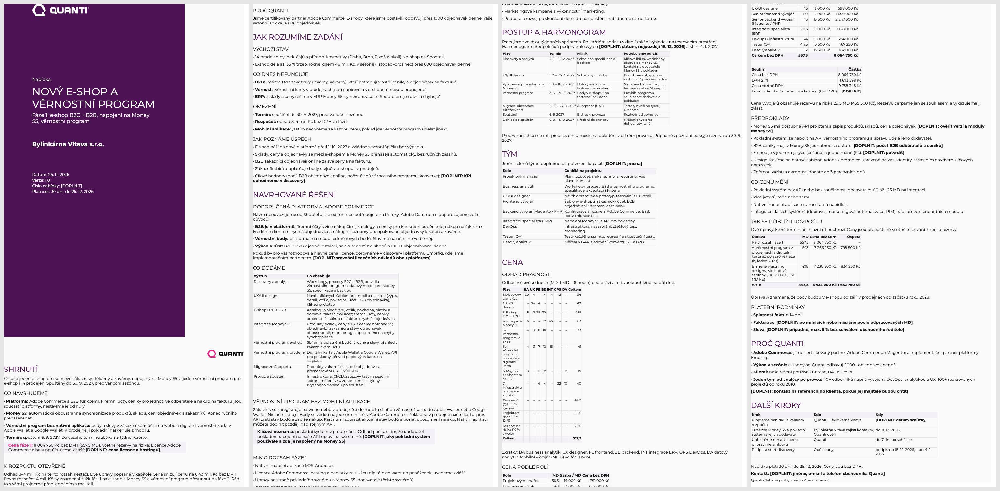
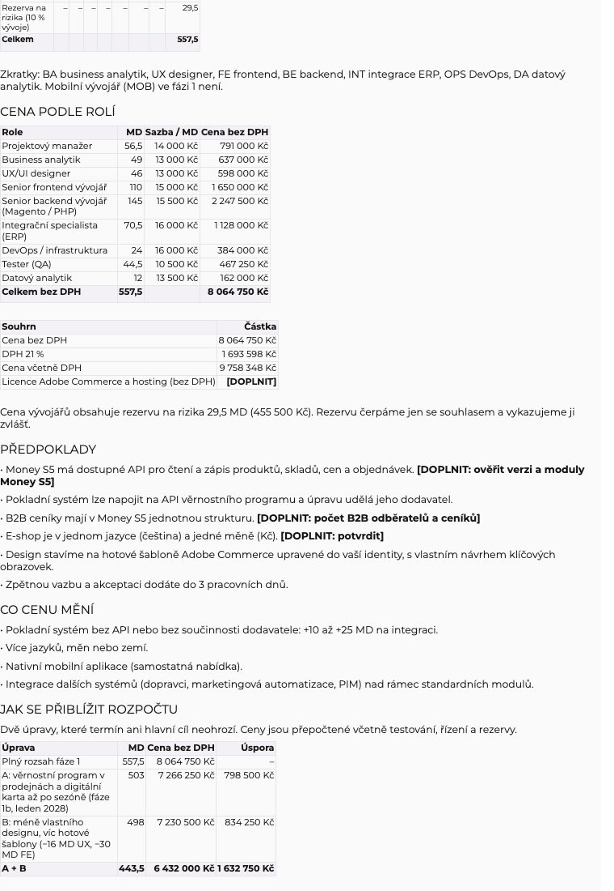

> 🌍 Read this in: **English** | [Česky](04-offers.cs.md)

# 04 · Offers, step by step

## Exercise 5 · A priced offer (35 min)

1. **New** conversation, folder `sample-data`.
2. Paste and send:

   ```
   Skillem quanti-offer připrav nabídku pro Bylinkárnu Vltava podle offer/client-brief.md a ceníku
   offer/rate-card.xlsx (dodržuj pravidla na listu Pravidla). První fáze: e-shop B2C + B2B
   napojený na Money S5 a věrnostní program bez nativní mobilní aplikace; platformu doporuč.
   Výstup DOCX.
   ```

3. If Claude asks (budget, deadline, scope), answer from the brief: 3–4 mil. Kč excl. VAT,
   30. 9. 2027. About 4–6 minutes.
4. Open the DOCX in Word. Check:
   - sections in this order: summary, understanding, solution, plan, team, price, why Quanti,
     next steps; purple cover with the pink panel and the white logo;
   - the price table shows MD × rate per role, PM = 12 % and QA = 15 % of the right base, totals
     excl. VAT, VAT 21 %, incl. VAT: **recompute one line yourself**;
   - licences are `[DOPLNIT]`, not a guessed number;
   - the hand-over report in the chat lists open `[DOPLNIT]`s and price-changing assumptions.

   
   

> The estimate (man-days) differs between runs; the arithmetic does not. In the room compare
> the MD tables, not the totals.

## Background


An offer is where a wrong number costs real money. The `quanti-offer` skill is built around
that:

1. **Inputs first.** Claude lists what it has (brief, rate card, your notes) and stops if the
   rate card is missing. It never guesses day rates.
2. **Estimate before price.** Man-days per role and phase, with assumptions, then the price.
3. **Arithmetic in code.** MD × rate, the rules from the rate card (PM and QA percentages, risk
   reserve), VAT: computed with Python, not "in the head" of the model.
4. **Claims only from sources.** References and numbers from the brief or `approved-claims.md`;
   everything else becomes `[DOPLNIT: …]`.
5. **Brand.** `quanti-brand` shapes the DOCX and the wording.
6. **Hand-over report.** Total and how it was computed, open `[DOPLNIT]`s, price-changing
   assumptions, parts of the brief not answered.

## Your job in the loop

Claude drafts; you own the offer. Before anything goes to a client:

- Recompute one line of the price table yourself.
- Read every `[DOPLNIT]` and fill it or delete the sentence.
- Check the scope boundary ("what is not included"): this is where disputes start.
- Check the dates against the client's deadline.

## Rate card

`sample-data/offer/rate-card.xlsx` is **fictional**. In real use, keep the real rate card in one
place the whole team reads (a Drive or SharePoint file through a connector, or inside the
plugin), so nobody pastes an old version into a conversation.
