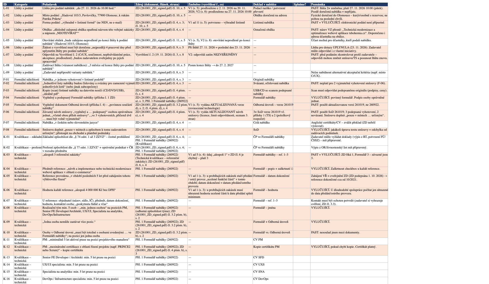
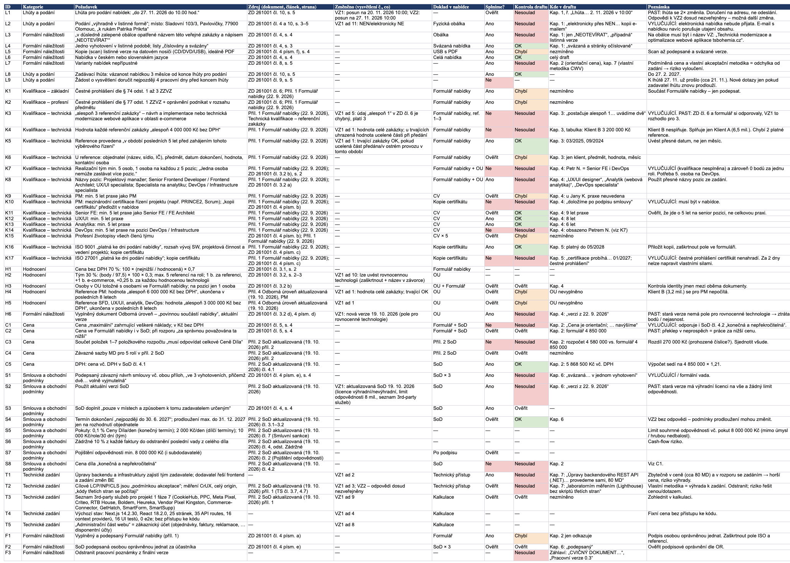

> 🌍 Read this in: [English](05-tenders.md) | **Česky**

# 05 · Veřejné zakázky krok za krokem

## Cvičení 6 · Matice požadavků a go/no-go (30 min)

1. **New** konverzace, složka `sample-data`.
2. Vložte a odešlete:

   ```
   Skillem tender-check zpracuj zakázku ve složce tender/ (všechny dokumenty včetně vysvětlení;
   složku draft/ zatím ignoruj). Udělej soupis dokumentů, matici požadavků do Matice_TSB.xlsx,
   vysvětli hodnocení a dej go/no-go pro Quanti.
   ```

3. Asi 5–7 minut. Otevřete `Matice_TSB.xlsx` v Excelu a přečtěte shrnutí v chatu. Kontrola
   podle seznamu ve [cvičeních](exercises.cs.md): lhůta **27. 11. 2026 10:00** a jak se
   posouvala, **3** reference ≥ 4 mil. Kč, aktualizovaná smlouva z 19. 10., papírové podání,
   ISO 9001 + 27001, hodnocení 70/30, CWV jako akceptační podmínka, zdroj u každého řádku.

   

4. Porovnejte se `solutions/tender-answer-key.md` (68 řádků): co Claude vynechal, co přidal,
   ačkoli to v dokumentech není?

## Cvičení 7 · Kontrola rozpracované nabídky (20 min, domácí úkol, když nezbude čas)

1. Stejná konverzace. Vložte a odešlete:

   ```
   Skillem tender-check zkontroluj rozpracovanou nabídku tender/draft/Quanti_nabidka_TSB_pracovni.docx
   proti zadávacím podmínkám ve složce tender/. Blokující problémy první.
   ```

2. Kontrola podle `solutions/draft-bid-key.md`: stará lhůta, elektronické podání, nesoulad cen,
   „orientační“ cena, 2 reference místo 3, reference pod 4 mil. Kč, jedna osoba ve dvou rolích,
   chybějící certifikát PM, ISO 27001 „v přípravě“. ISO 9001 a datum 30. 6. 2027 se hlásit
   **nesmí**.

   

## Pozadí


Cvičná zakázka je skutečná a veřejná: T.S.BOHEMIA a.s., *Technická modernizace a optimalizace
webové aplikace tsbohemia.cz* ([NEN N006/26/V00032057](https://nen.nipez.cz/verejne-zakazky/detail-zakazky/N006-26-V00032057)).
Jde o výběrové řízení podle pravidel OP TAK, výslovně **ne** podle ZZVZ, ale kvalifikaci
přebírá ze ZZVZ. `sample-data/tender/` obsahuje všech deset dokumentů zveřejněných na NEN.

## Proč je to dobré cvičení

Požadavky se v čase mění. Kdo čte jen zadávací dokumentaci, má několik věcí špatně:

| Zadávací dokumentace říká | Pozdější dokumenty říkají |
|---|---|
| Lhůta 2. 11. 2026 | 20. 11. (vysvětlení 1), pak **27. 11. 2026 10:00** (vysvětlení 2) |
| „alespoň 1 reference“ | **3 reference**, každá e-commerce, ≥ 4 mil. Kč bez DPH, posledních 5 let (vysvětlení 1, Ad 5) |
| Smlouva a Odborná úroveň z 22. 9. | **Aktualizované** přílohy z 19. 10.: limit odpovědnosti 8 mil. Kč, rozdělení licencí |
| Core Web Vitals „změřit před a po“ | Cílové hodnoty jsou **podmínkou akceptace** na datech CrUX, včetně skriptů třetích stran (vysvětlení 1, Ad 3) |

A některá pravidla jsou pro digitální agenturu neobvyklá: **listinné podání** v zalepené obálce
s názvem zakázky a „NEOTEVÍRAT“, smlouva ve 3 vyhotoveních (2 volně vyjímatelná), ISO 9001
**a** ISO 27001 platné ke dni podání a „liší-li se cena ve formuláři a ve smlouvě, platí nižší“.

## Jak funguje `tender-check`

1. **Soupis**: každý dokument, jeho datum a která verze každé přílohy platí. Pozdější přebíjí
   dřívější.
2. **Matice** (XLSX): jeden požadavek na řádek, se zdrojem (dokument, článek, strana), čím byl
   změněn, jakým dokladem ho v nabídce prokážeme a s pastmi.
3. **Hodnocení**: kritéria, váhy a vzorec s příkladem. Zde: cena 70 %, odborná úroveň týmu
   30 % (5 rolí, body za reference a technologie).
4. **Go / no-go**: vylučující podmínky, pracnost, rizika smlouvy (10% zádržné do odstranění
   poslední vady, pokuty, žádná lhůta pro převzetí), dotazy, které poslat do lhůty pro vysvětlení.
5. **Kontrola rozpracované nabídky**: řádek po řádku OK / Chybí / Nesoulad, blokující problémy
   první.

## Co zůstává na vás

- Vylučující podmínky ověřte proti faktům, která znáte jen vy: certifikáty, reference, lidé.
- Rizika smlouvy čtěte s někým, kdo smlouvy podepisuje.
- V den podání znovu zkontrolujte NEN; nové vysvětlení může přijít hodinu před lhůtou (tady se
  to stalo).
