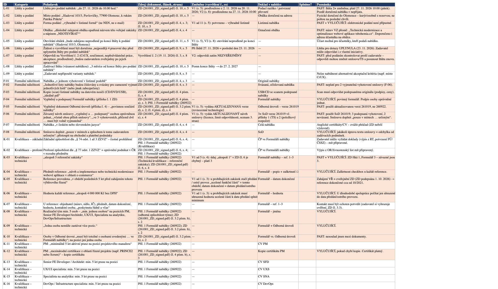
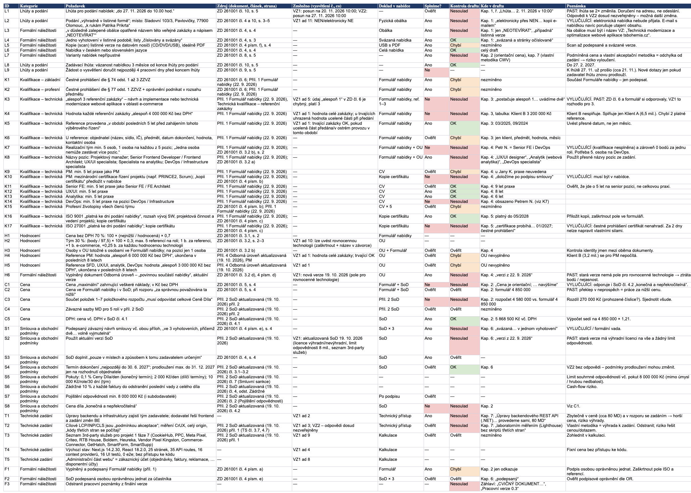

> 🌍 Read this in: **English** | [Česky](05-tenders.cs.md)

# 05 · Public tenders, step by step

## Exercise 6 · Requirements matrix and go/no-go (30 min)

1. **New** conversation, folder `sample-data`.
2. Paste and send:

   ```
   Skillem tender-check zpracuj zakázku ve složce tender/ (všechny dokumenty včetně vysvětlení;
   složku draft/ zatím ignoruj). Udělej soupis dokumentů, matici požadavků do Matice_TSB.xlsx,
   vysvětli hodnocení a dej go/no-go pro Quanti.
   ```

3. About 5–7 minutes. Open `Matice_TSB.xlsx` in Excel and read the summary in the chat. Check
   the list in [exercises](exercises.md#6-tender-requirements-matrix-and-gono-go-30-min):
   deadline **27. 11. 2026 10:00** and how it moved, **3** references ≥ 4 M Kč, the updated
   contract of 19. 10., paper submission, ISO 9001 + 27001, 70/30 evaluation, CWV acceptance
   condition, a source on every row.

   

4. Compare with `solutions/tender-answer-key.md` (68 rows): what did Claude miss, what did it
   add that is not in the documents?

## Exercise 7 · Check a draft bid (20 min, take-home if time runs out)

1. Same conversation. Paste and send:

   ```
   Skillem tender-check zkontroluj rozpracovanou nabídku tender/draft/Quanti_nabidka_TSB_pracovni.docx
   proti zadávacím podmínkám ve složce tender/. Blokující problémy první.
   ```

2. Check against `solutions/draft-bid-key.md`: old deadline, electronic submission, price
   mismatch, "indicative" price, 2 references instead of 3, a reference under 4 M Kč, one
   person in two roles, missing PM certificate, ISO 27001 in progress. ISO 9001 and the
   30. 6. 2027 date must **not** be flagged.

   

## Background


The exercise tender is real and public: T.S.BOHEMIA a.s., *Technická modernizace a optimalizace
webové aplikace tsbohemia.cz* ([NEN N006/26/V00032057](https://nen.nipez.cz/verejne-zakazky/detail-zakazky/N006-26-V00032057)).
It is an OP TAK grant procurement, explicitly **not** under ZZVZ, but it borrows ZZVZ
qualification rules. `sample-data/tender/` holds all ten documents published on NEN.

## Why it is a good exercise

The requirements change over time. A bidder who reads only the main document gets several
things wrong:

| Main document says | Later documents say |
|---|---|
| Deadline 2. 11. 2026 | 20. 11. (clarification 1), then **27. 11. 2026 10:00** (clarification 2) |
| "at least 1 reference" | **3 references**, each e-commerce, ≥ 4 M Kč excl. VAT, last 5 years (clarification 1, Ad 5) |
| Contract and team annex of 22. 9. | **Updated** annexes of 19. 10.: liability cap 8 M Kč, licence split |
| Core Web Vitals "measure before and after" | Targets are an **acceptance condition** on CrUX field data, third parties included (clarification 1, Ad 3) |

And some rules are unusual for a digital agency: **paper submission** in a sealed envelope with
the tender name and "NEOTEVÍRAT", the contract in 3 copies (2 removable), ISO 9001 **and**
ISO 27001 valid on the submission date, and "if the price in the form and the contract
differ, the lower one counts".

## How `tender-check` works

1. **Inventory**: every document, its date, which version of each annex is current. Later
   overrides earlier.
2. **Matrix** (XLSX): one requirement per row, with source (document, article, page), what
   changed it, the evidence needed in the bid, and traps.
3. **Evaluation**: criteria, weights and formula, with a worked example. Here: price 70 %,
   team expertise 30 % (5 roles, points for references and technologies).
4. **Go / no-go**: knock-outs, effort, contract risks (10 % retention until the last defect,
   penalties, no acceptance deadline), questions to send before the clarification cut-off.
5. **Draft-bid check**: row by row, OK / Chybí / Nesoulad, blocking issues first.

## What stays your job

- Check the knock-outs against facts only you know: certificates, references, people.
- Read the contract risks with someone who signs contracts.
- Re-check NEN on the day you submit; a new clarification can arrive an hour before the deadline
  (it happened here).
