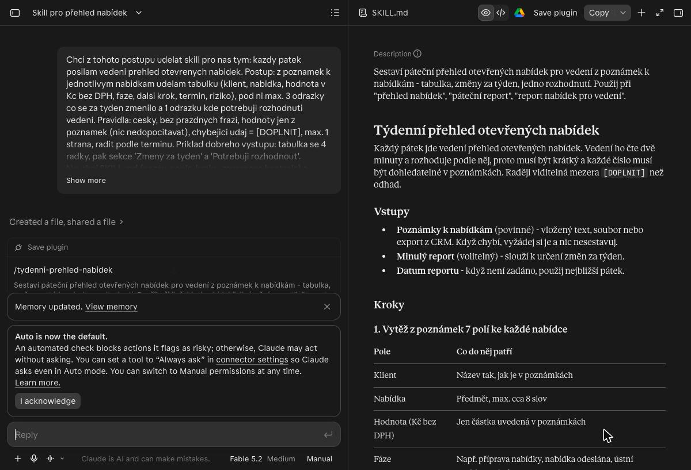

> 🌍 Read this in: [English](06-own-skill.md) | **Česky**

# 06 · Vlastní skill krok za krokem

## Cvičení 8 · Vlastní skill (15 min)

1. Vyberte jeden úkol, který děláte každý týden (follow-up po první schůzce, jednostránková
   reference, páteční přehled pipeline).
2. **New** konverzace. Vložte, doplňte tři závorky, odešlete:

   ```
   Chci z tohoto postupu udělat skill pro náš tým: <popis postupu, příklad dobrého výstupu,
   pravidla>. Navrhni SKILL.md (název, popis, kroky, závěrečná kontrola) a vyzkoušej ho na
   tomto příkladu: <konkrétní vstup>.
   ```

3. Claude vrátí kartu **Save plugin**, `SKILL.md` a testovací běh. Přečtěte řádek
   **description**: musí používat slova, která váš tým opravdu říká („páteční report“, „přehled
   nabídek“), protože ta skill spouštějí.

   

4. Vyzkoušejte ho na druhém příkladu. Opravujte instrukce, ne výstup.
5. Pro sebe: klikněte na **Save** na kartě. Pro tým: pošlete `SKILL.md` správci pluginu
   (nasazení níže).

## Pozadí


## Kdy si úkol zaslouží skill

Udělali jste ho třikrát, pokaždé jste vysvětlovali stejná pravidla a výsledek na nich závisí.
Příklady z obchodu: follow-up po první schůzce, referenční one-pager, týdenní zpráva
o pipeline, odpověď na vysvětlení zadávacích podmínek.

## Anatomie

```
muj-skill/
  SKILL.md          # frontmatter: name, description; pak instrukce
  references/       # delší podklady, které Claude čte jen když je potřebuje
  assets/           # loga, šablony
```

**Popis** (description) rozhoduje, kdy se skill použije: napište, co dělá, a slova, která lidé
opravdu říkají („follow-up“, „zápis ze schůzky“). **Tělo** je checklist, podle kterého by
postupoval nový kolega: vstupy, kroky, formát výstupu, závěrečná kontrola.

## Vytvoření v Claude

Požádejte Claude, ať skill vytvoří s vámi (vestavěný `skill-creator`, nebo
`create-cowork-plugin` pro celý plugin). Dejte mu skutečný příklad dobrého výstupu a pravidla,
která pořád opakujete. Vyzkoušejte ho na druhém příkladu; opravujte instrukce, ne výstup.

## Nasazení pro tým

| Krok | Kdo | Kde |
|---|---|---|
| Upravit skill v `plugins/quanti-sales/`, zvýšit `version` v `plugin.json` | Vlastník skillu | Tento repozitář |
| `scripts/build-plugin.sh` → `dist/quanti-sales.zip` | Vlastník skillu | Terminál |
| Nahrát; stejné jméno přepíše starou verzi | Vlastník organizace | Organization settings → Plugins & skills → Add → Upload a plugin |
| Nastavit *Installed by default* (nebo *Required*) pro obchodní skupinu | Vlastník organizace | Nastavení instalace pluginu |

Alternativa: přidat tento repozitář jako marketplace pluginů (má
`.claude-plugin/marketplace.json`); aktualizace pak přijdou s každým pushem. Privátní
repozitář ale vyžaduje přístup na GitHub pro každého uživatele, takže pro obchodní tým je
nahrání zipu jednodušší.
