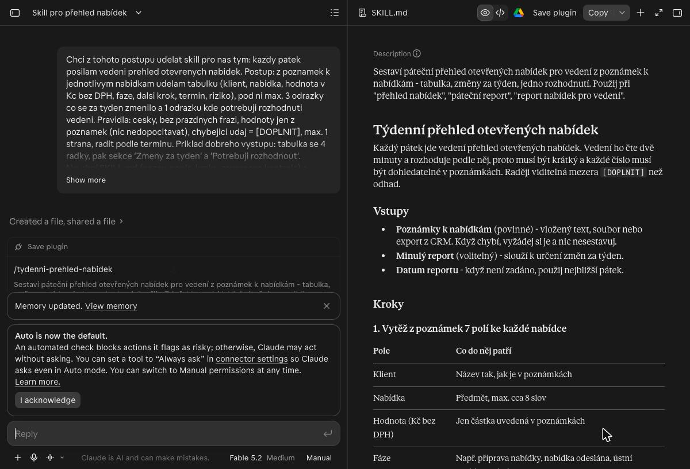

> 🌍 Read this in: **English** | [Česky](06-own-skill.cs.md)

# 06 · Your own skill, step by step

## Exercise 8 · Your own skill (15 min)

1. Pick one task you repeat every week (a follow-up after a first call, a reference one-pager,
   the Friday pipeline note).
2. **New** conversation. Paste, fill in the three brackets, send:

   ```
   Chci z tohoto postupu udělat skill pro náš tým: <popis postupu, příklad dobrého výstupu,
   pravidla>. Navrhni SKILL.md (název, popis, kroky, závěrečná kontrola) a vyzkoušej ho na
   tomto příkladu: <konkrétní vstup>.
   ```

3. Claude returns a **Save plugin** card, the `SKILL.md` and a test run. Read the
   **description** line: it must use the words your team actually says ("páteční report",
   "přehled nabídek"), because that is what triggers the skill.

   

4. Test it on a second example. Fix the instructions, not the output.
5. To keep it for yourself, click **Save** on the card. To give it to the team, send the
   `SKILL.md` to the plugin owner (rollout below).

## Background


## When a task deserves a skill

You did it three times, you explained the same rules each time, and the result depends on
those rules. Examples from sales: follow-up after a first call, a reference one-pager, a
weekly pipeline note, a reply to a tender clarification.

## Anatomy

```
my-skill/
  SKILL.md          # frontmatter: name, description; then the instructions
  references/       # long material Claude reads only when needed
  assets/           # logos, templates
```

The **description** decides when the skill is used: write what it does and the words people
actually say ("follow-up", "zápis ze schůzky"). The **body** is a checklist a new colleague
could follow: inputs, steps, output format, a final check.

## Creating one in Claude

Ask Claude to create the skill with you (the built-in `skill-creator`, or `create-cowork-plugin`
for a whole plugin). Give it a real example of a good output and the rules you keep repeating.
Test it on a second example; fix the instructions, not the output.

## Rolling out to the team

| Step | Who | Where |
|---|---|---|
| Change the skill in `plugins/quanti-sales/`, bump `version` in `plugin.json` | Skill owner | This repo |
| `scripts/build-plugin.sh` → `dist/quanti-sales.zip` | Skill owner | Terminal |
| Send the new `dist/quanti-sales.zip` to the team | Skill owner | E-mail or shared folder |
| Each person: **Plugins → … next to Quanti sales → Remove**, then **Add → Upload plugin** with the new zip (01-setup, step 1) | Everyone | Claude |

The plugin is installed per person, by uploading the zip; there is no organisation-wide
installation for now.
