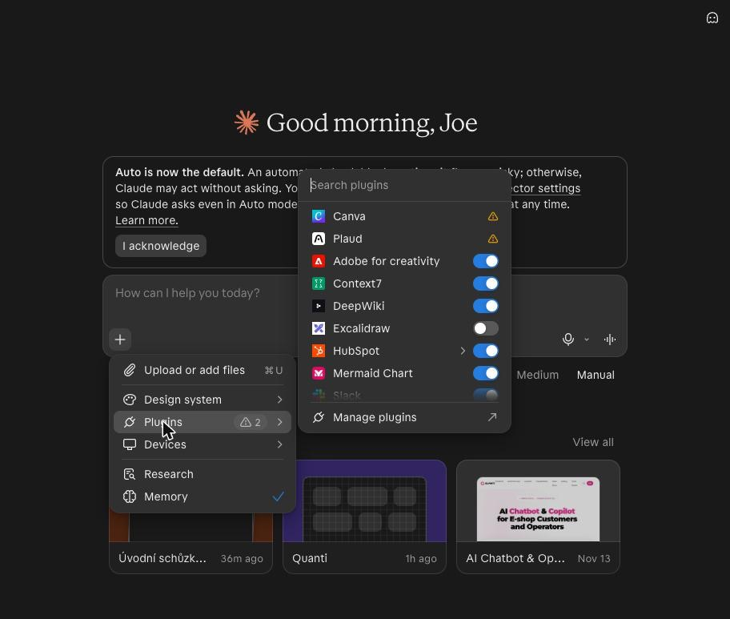
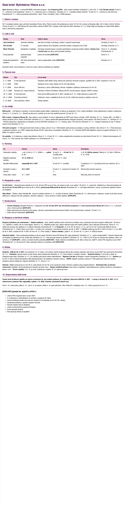

> 🌍 Read this in: [English](07-hubspot.md) | **Česky**

# 07 · HubSpot: od dealu k nabídce a zpět krok za krokem

Účastníci pracují na **svém otevřeném dealu** přes HubSpot konektor. Lektor ukazuje stejné
prompty na `sample-data/hubspot/`, exportu fiktivního dealu Bylinkárna Vltava ve tvaru, jaký
vrací konektor.

## Než začnete

1. HubSpot je připojený (01-setup, krok 5 ze dne předem) a v konverzaci zapnutý:
   **+** → **Plugins** → přepínač HubSpot zapnutý.

   

2. Znáte název svého dealu v HubSpotu.

## Cvičení 9a · Brief (15 min)

1. **New** konverzace, složka `sample-data`, HubSpot zapnutý.
2. Vložte a odešlete. Účastníci nahradí `ve složce hubspot/` za `v HubSpotu` a
   `Bylinkárna Vltava` za název svého dealu:

   ```
   Skillem deal-brief připrav podklady k nabídce pro deal Bylinkárna Vltava ve složce hubspot/:
   kdo je kdo, co chtějí, termíny, rozpočet, konkurence, rozpory a otevřené otázky, rizika,
   další krok. Ke každému faktu zdroj (typ aktivity + datum). Ulož jako brief_Bylinkarna.md.
   ```

3. S konektorem Claude nejdřív deal vyhledá; když jich sedí víc, zeptá se, který. Pak přečte
   firmu, kontakty a všechny aktivity od nejstarší. Asi 2 minuty.
4. Otevřete brief. Kontrola:
   - každý fakt má zdroj v závorce, např. *(E-mail 18. 11.)*;
   - **Termíny** ukazují oba e-maily s termíny a používají novější; brief si všimne, že
     „pátek 5. 12.“ z e-mailu je sobota;
   - **Lidé a role** obsahují majitelku Marii Vltavskou, označenou jako známou jen z druhé ruky;
   - částka dealu je označená jako náš odhad, ne rozpočet klienta;
   - 2,4 mil. konkurence má svou výhradu (bez věrnostního programu, ruční synchronizace);
   - mobilní aplikace je otevřená otázka, ne rozhodnutí;
   - na konci seznam `[DOPLNIT]`.

   

## Cvičení 9b · Předání do nabídky (volitelné)

```
Z briefu udělej client-brief pro quanti-offer a připrav nabídku ve dvou variantách:
bez mobilní aplikace a s ní. Ceník offer/rate-card.xlsx. Výstup DOCX.
```

Stejné kontroly jako ve cvičení 5 (04-offers), dvakrát.

## Cvičení 9c · Zápis zpět (jen účastníci, na vlastním dealu)

1. Ve stejné konverzaci pošlete:

   ```
   Zapiš do HubSpotu k tomuto dealu poznámku se shrnutím nabídky a otevřenými body, založ úkol
   „Follow-up nabídka“ na 3 pracovní dny po odeslání a posuň deal do fáze Sent Offer. Před každým
   zápisem mi ukaž, co přesně změníš.
   ```

2. U každého zápisu Claude ukáže tabulku: objekt, ID, vlastnost, současná hodnota, nová
   hodnota, a zeptá se **Approve?**. Přečtěte ji. *Ano* jen když hodnoty sedí; *Ne* zápis
   zastaví.
3. Zkontrolujte v HubSpotu: poznámka je u dealu (do 150 slov), úkol existuje s datem
   a vlastníkem, fáze se posunula o jeden krok dopředu.

Lektor nemá právo zápisu: na ukázkové složce to Claude řekne a dá text poznámky k vložení.

## Když něco nejde

| Co vidíte | Proč | Udělejte |
|---|---|---|
| „Deal jsem nenašel“ | Jiný název v HubSpotu, nebo HubSpot vypnutý | + → Plugins → HubSpot zapnout; použijte přesný název dealu z HubSpotu |
| Fakta bez zdrojů | Skill se nenačetl | Začněte „Skillem deal-brief …“ |
| Jediný termín, bez historie | Claude četl jen shrnutí | Napište: „Přečti plné texty všech aktivit a oprav termíny.“ |
| Claude zapisuje bez dotazu | Režim Auto a u konektoru vypnuté „Always ask“ | Napište *Stop*; v nastavení konektoru dejte HubSpotu „Always ask“ |
| „Nemám právo zápisu“ | Vaše role v HubSpotu | Čtení funguje; 9c vynechte nebo udělejte s kolegou, který smí upravovat |

## Pozadí

`deal-brief` sesbírá deal, firmu, kontakty a všechny aktivity, napíše jednostránkový český brief
s deseti pevnými sekcemi (klient v kostce, lidé a role, časová osa, požadavky se zdroji, termíny
s vítězstvím novějšího zdroje, rozpočet vs. náš odhad, konkurence, rozpory, rizika, další krok),
předá ho skillu `quanti-offer` nebo `quanti-brand` a zapisuje zpět jen na vyžádání, jen dopředu
v pipeline, nikdy Closed Won/Lost, nikdy e-maily. Osobní údaje zůstávají u jmen, rolí
a pracovních e-mailů.
