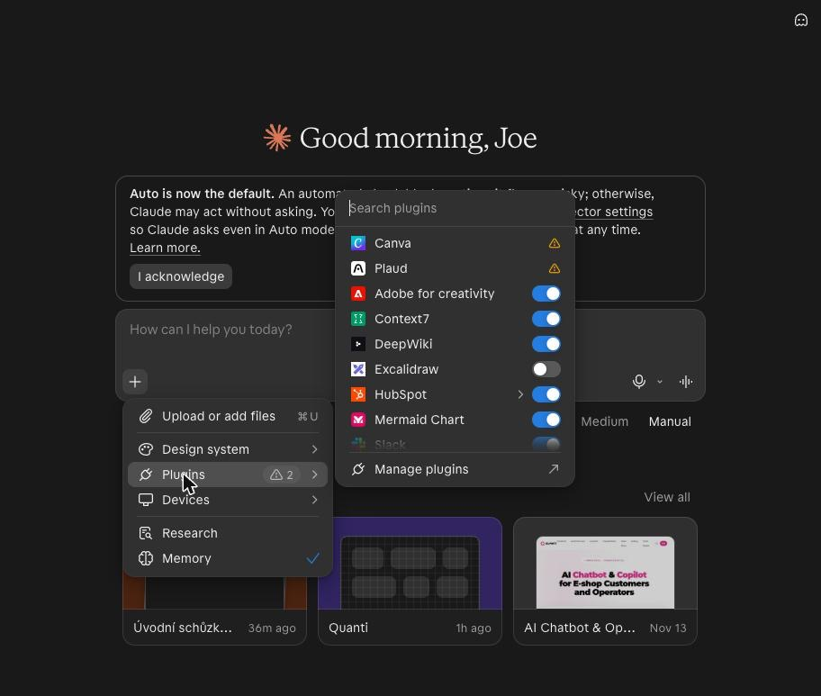
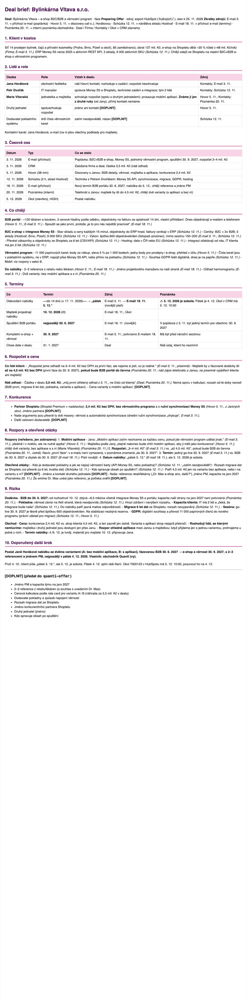

> 🌍 Read this in: **English** | [Česky](07-hubspot.cs.md)

# 07 · HubSpot: from a deal to an offer and back, step by step

Participants work on **their own open deal** through the HubSpot connector. The facilitator
shows the same prompts on `sample-data/hubspot/`, an export of the fictional deal Bylinkárna
Vltava in the shape the connector returns.

## Before you start

1. HubSpot is connected (01-setup, day-before step 5) and switched on in the conversation:
   **+** → **Plugins** → HubSpot toggle on.

   

2. You know the name of your deal in HubSpot.

## Exercise 9a · The brief (15 min)

1. **New** conversation, folder `sample-data`, HubSpot on.
2. Paste and send. Participants replace `ve složce hubspot/` with `v HubSpotu` and
   `Bylinkárna Vltava` with their deal's name:

   ```
   Skillem deal-brief připrav podklady k nabídce pro deal Bylinkárna Vltava ve složce hubspot/:
   kdo je kdo, co chtějí, termíny, rozpočet, konkurence, rozpory a otevřené otázky, rizika,
   další krok. Ke každému faktu zdroj (typ aktivity + datum). Ulož jako brief_Bylinkarna.md.
   ```

3. With the connector Claude first searches the deal; if several match, it asks which one. Then
   it reads the company, contacts and every activity, oldest first. About 2 minutes.
4. Open the brief. Check:
   - every fact has a source in brackets, e.g. *(E-mail 18. 11.)*;
   - **Termíny** shows both deadline e-mails and uses the newer one; it notices that the
     e-mail's "pátek 5. 12." is a Saturday;
   - **Lidé a role** includes the owner Marie Vltavská, marked as known only second-hand;
   - the deal amount is labelled as our own guess, not the client's budget;
   - the competitor's 2,4 mil. carries its caveat (no loyalty programme, manual sync);
   - the mobile app is an open question, not a decision;
   - a `[DOPLNIT]` list at the end.

   

## Exercise 9b · Hand over to the offer (optional)

```
Z briefu udělej client-brief pro quanti-offer a připrav nabídku ve dvou variantách:
bez mobilní aplikace a s ní. Ceník offer/rate-card.xlsx. Výstup DOCX.
```

Same checks as exercise 5 (04-offers), twice.

## Exercise 9c · Log it back (participants only, on their own deal)

1. In the same conversation send:

   ```
   Zapiš do HubSpotu k tomuto dealu poznámku se shrnutím nabídky a otevřenými body, založ úkol
   „Follow-up nabídka“ na 3 pracovní dny po odeslání a posuň deal do fáze Sent Offer. Před každým
   zápisem mi ukaž, co přesně změníš.
   ```

2. For each write Claude shows a table: object, ID, property, current value, new value, and
   asks **Approve?**. Read it. Answer *Ano* only if the values are right; *Ne* stops it.
3. Check in HubSpot: the note is on the deal (under 150 words), the task exists with a date
   and owner, the stage moved one step forward.

The facilitator has no write rights: on the demo folder Claude says so and gives the note text
to paste.

## If it goes wrong

| What you see | Why | Do this |
|---|---|---|
| "I can't find the deal" | Name differs in HubSpot, or HubSpot is off | + → Plugins → HubSpot on; use the exact deal name from HubSpot |
| Facts without sources | Skill not loaded | Start with "Skillem deal-brief …" |
| A single deadline, no history | Claude read summaries only | Ask: "Přečti plné texty všech aktivit a oprav termíny." |
| Claude writes without asking | Permission mode Auto and the connector's "Always ask" off | Say *Stop*; set HubSpot to "Always ask" in connector settings |
| "No write access" | Your HubSpot role | Read part works; skip 9c or do it with a colleague who can edit |

## Background

`deal-brief` collects the deal, company, contacts and all activities, writes a one-page Czech
brief with ten fixed sections (client in short, people and roles, timeline, requirements with
sources, dates with the newer source winning, budget vs our estimate, competition,
contradictions, risks, next step), hands over to `quanti-offer` or `quanti-brand`, and logs
back only when asked, only forward along the pipeline, never Closed Won/Lost, never e-mails.
Personal data stays at names, roles and work e-mails.
