> 🌍 Read this in: [English](exercises.md) | **Česky**

# Cvičení

Každé cvičení: prompt ke vložení, na co se dívat, a **Hotovo, když**. Ke každému cvičení
založte **novou konverzaci** a povolte jí složku `~/Documents/qti-cowork-sales/sample-data`.
Klíče řešení jsou v `solutions/` (pro lektora).

## 0. Nastavení (10 min)

Postupujte podle [01-setup](01-setup.cs.md): plugin, složka, rychlý test.

**Hotovo, když**
- `quanti-sales` se čtyřmi skilly je v Customize → Plugins.
- Odpověď rychlého testu obsahuje `#DF2686`, `#4D1254`, Montserrat a pravidlo bílého loga.

## 1. Tón ze skutečných textů (20 min)

```
Ve složce tone-corpus/ je 58 veřejných textů Quanti. Popiš náš tón: 5–7 zásad, ke každé
dvojici „takhle ano / takhle ne“ s citací z korpusu, seznam slov, kterým se vyhýbáme, a jak
oslovujeme čtenáře. Pak to porovnej se sekcí Tone of voice ve skillu quanti-brand a navrhni
konkrétní úpravy skillu. Ulož jako brand/tone-of-voice.md.
```

S nainstalovaným pluginem `brand-voice` zkuste nad stejnou složkou
`/brand-voice:generate-guidelines` a porovnejte.

**Hotovo, když**
- Každá zásada má aspoň jednu skutečnou citaci (jednu si v korpusu dohledejte).
- Je tu seznam konkrétních úprav skillu, ne „vypadá dobře“.

## 2. Design systém z brand podkladů (20 min)

V **Settings → Capabilities → Design systems** založte nový design systém a nahrajte ze složky
`brand/`: `brand-brief.md`, `tokens.json`, `quanti-logo.svg`, `quanti-logo-white.svg`,
`fonts/Montserrat-*.ttf`. Pojmenujte ho „Quanti“. **Nepublikujte** ho.

Pak v nové konverzaci s tímto design systémem:

```
Udělej jeden titulní slide a jeden obsahový slide pro úvodní schůzku s Bylinkárnou Vltava.
```

**Hotovo, když**
- Náhled má magentu `#DF2686` jako jediný akcent, fialovou `#4D1254` na tmavých plochách,
  Montserrat a nadpisy verzálkami.
- Titulní slide má bílé logo na fialové.

## 3. Prezentace z poptávky (25 min)

```
Použij skill quanti-brand. Z podkladu offer/client-brief.md připrav úvodní prezentaci Quanti
pro Bylinkárnu Vltava: 6 slidů, 16:9, PPTX. Struktura: titulní slide, jak rozumíme vaší
situaci, co navrhujeme, jak bychom postupovali, proč Quanti (jen schválená tvrzení), další
krok. Ulož jako Bylinkarna_uvod.pptx a na konci vypiš, co jsi zkontroloval.
```

**Hotovo, když**
- `Bylinkarna_uvod.pptx` má 6 slidů v Montserratu a jen barvy z palety.
- Slide 2 cituje poptávku (14 prodejen, Money S5, 30. 9. 2027).
- „Proč Quanti“ používá jen tvrzení z `approved-claims.md`; ostatní je `[DOPLNIT]`.
- Poslední slide má jeden konkrétní další krok.

<details><summary>Snímky z posledního zkušebního běhu (2026-11-25)</summary>

*Prezentace, druhý běh*

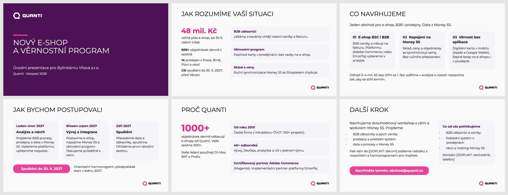

*Prompt a odpověď*

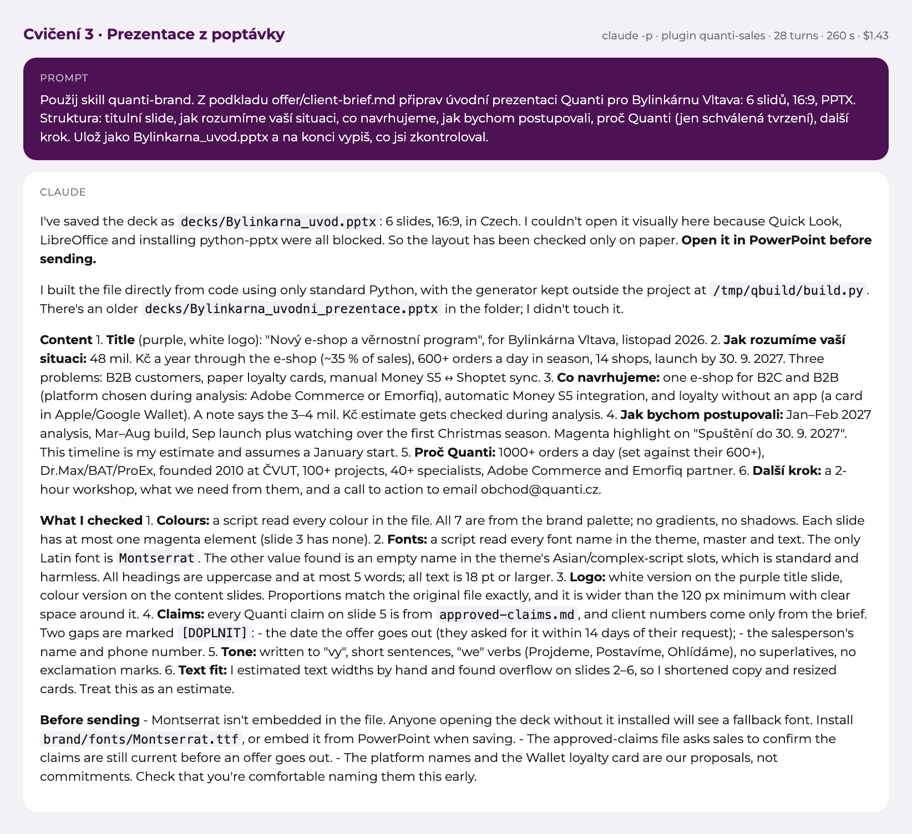

</details>

## 4. Kontrola a oprava prezentace mimo brand (20 min)

```
Zkontroluj prezentaci decks/Bylinkarna_uvodni_prezentace.pptx skillem deck-review.
```

Přečtěte si zprávu, pak:

```
Oprav ji podle zprávy a ulož s příponou _opraveno.
```

**Hotovo, když**
- Zpráva najde aspoň 12 chyb ze `solutions/deck-review-key.md`, včetně roztaženého loga,
  barevného loga na fialové a neschválených tvrzení (200 mil. Kč, ISO 27001).
- Opravená prezentace nemá modrou, zelenou, oranžovou, Calibri ani Times; tvrzení jsou
  odstraněná nebo `[DOPLNIT]`.

<details><summary>Snímky z posledního zkušebního běhu (2026-11-25)</summary>

*Před*

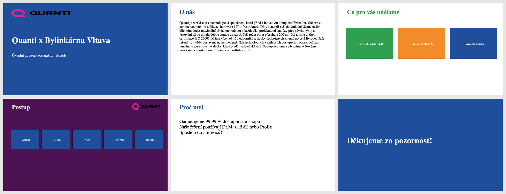

*Zpráva z kontroly*

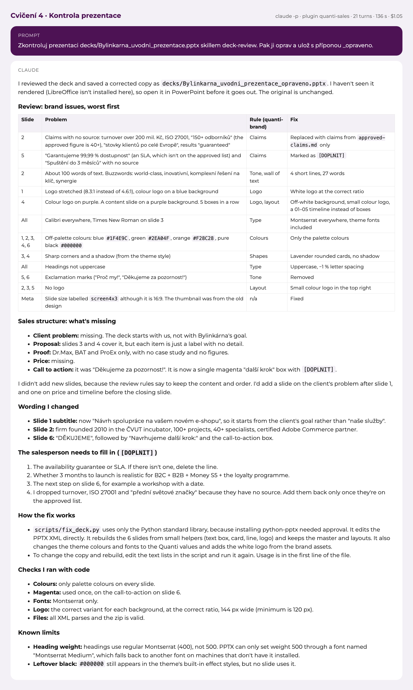

*Po opravě*

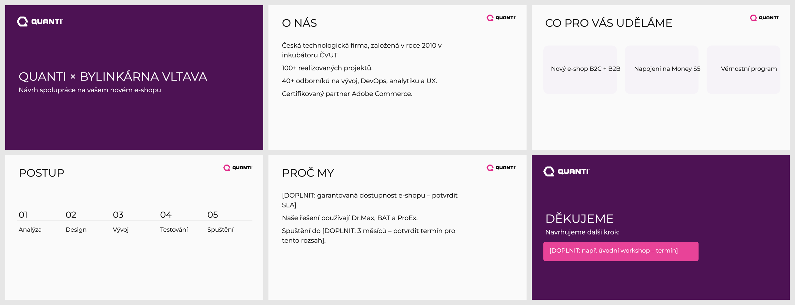

</details>

## 5. Naceněná nabídka (35 min)

```
Skillem quanti-offer připrav nabídku pro Bylinkárnu Vltava podle offer/client-brief.md a ceníku
offer/rate-card.xlsx (dodržuj pravidla na listu Pravidla). První fáze: e-shop B2C + B2B
napojený na Money S5 a věrnostní program bez nativní mobilní aplikace; platformu doporuč.
Výstup DOCX.
```

Pokud se Claude ptá, odpovězte (rozpočet a termín jsou v poptávce).

**Hotovo, když**
- DOCX má strukturu nabídky: shrnutí, porozumění zadání, řešení, postup, tým, cena, proč
  Quanti, další kroky.
- Cenová tabulka ukazuje MD × sazbu po rolích; PM = 12 % a QA = 15 % ze správného základu;
  součty bez DPH, DPH 21 %, s DPH. Jeden řádek přepočítejte sami.
- Licence jsou `[DOPLNIT]`, ne odhadnuté číslo.
- Předávací zpráva vypíše otevřená `[DOPLNIT]` a předpoklady, které mění cenu.

<details><summary>Snímky z posledního zkušebního běhu (2026-11-25)</summary>

*Nabídka DOCX, všechny strany*

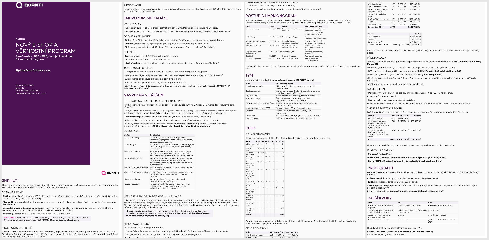

*Cenová část*

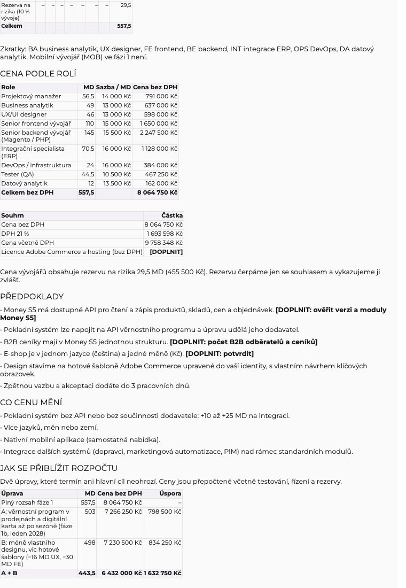

*Prompt a odpověď*

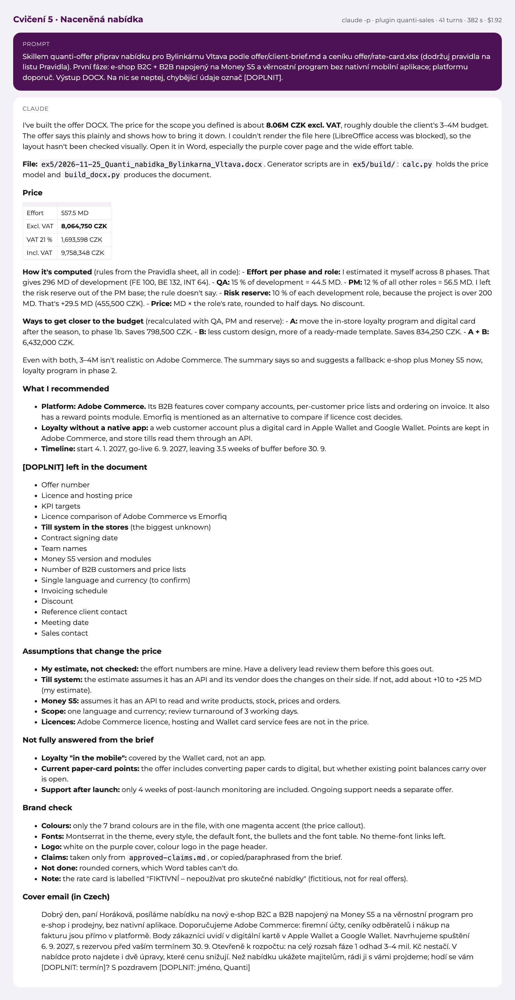

</details>

## 6. Matice požadavků zakázky a go/no-go (30 min)

```
Skillem tender-check zpracuj zakázku ve složce tender/ (všechny dokumenty včetně vysvětlení;
složku draft/ zatím ignoruj). Udělej soupis dokumentů, matici požadavků do Matice_TSB.xlsx,
vysvětli hodnocení a dej go/no-go pro Quanti.
```

**Hotovo, když** matice a shrnutí obsahují:
- aktuální lhůtu **27. 11. 2026 10:00** a jak se posouvala;
- **3** reference ≥ 4 mil. Kč bez DPH (ne „1“ ze ZD);
- **aktualizovanou** smlouvu a Odbornou úroveň (19. 10.) jako platné verze;
- listinné podání, obálku s názvem zakázky + „NEOTEVÍRAT“, smlouvu 3× (2 vyjímatelné);
- ISO 9001 + ISO 27001, 5 různých osob, certifikát PM;
- hodnocení 70 % cena / 30 % tým a pravidlo nižší ceny;
- cíle CWV jako podmínku akceptace na datech CrUX;
- u každého řádku zdroj (dokument + článek).

Porovnejte se `solutions/tender-answer-key.md` (68 řádků): co Claude vynechal a co přidal,
co v dokumentech není?

<details><summary>Snímky z posledního zkušebního běhu (2026-11-25)</summary>

*Matice požadavků*

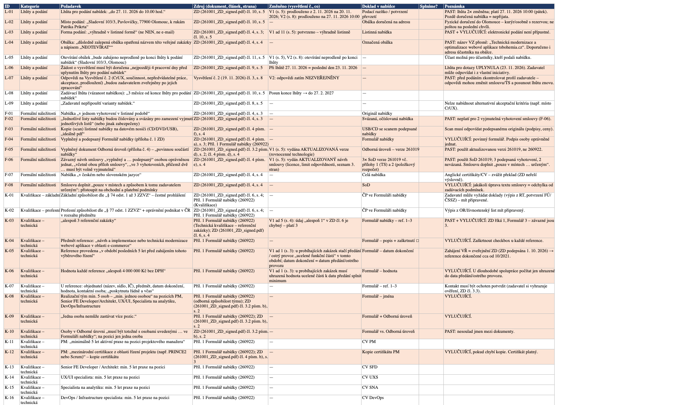

*Prompt a odpověď*

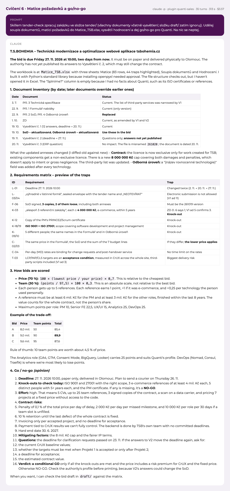

</details>

## 7. Kontrola rozpracované nabídky (20 min)

```
Skillem tender-check zkontroluj rozpracovanou nabídku tender/draft/Quanti_nabidka_TSB_pracovni.docx
proti zadávacím podmínkám ve složce tender/. Blokující problémy první.
```

**Hotovo, když**
- Jsou nalezené všechny blokující řádky ze `solutions/draft-bid-key.md`: stará lhůta,
  elektronické podání, nesoulad ceny (platí nižší), „orientační“ cena, 2 reference místo 3,
  reference pod 4 mil. Kč, jedna osoba ve dvou rolích, chybějící certifikát PM, ISO 27001
  v řízení.
- ISO 9001 a termín 30. 6. 2027 **nejsou** označené jako problém.

<details><summary>Snímky z posledního zkušebního běhu (2026-11-25)</summary>

*Kontrola draftu v matici*

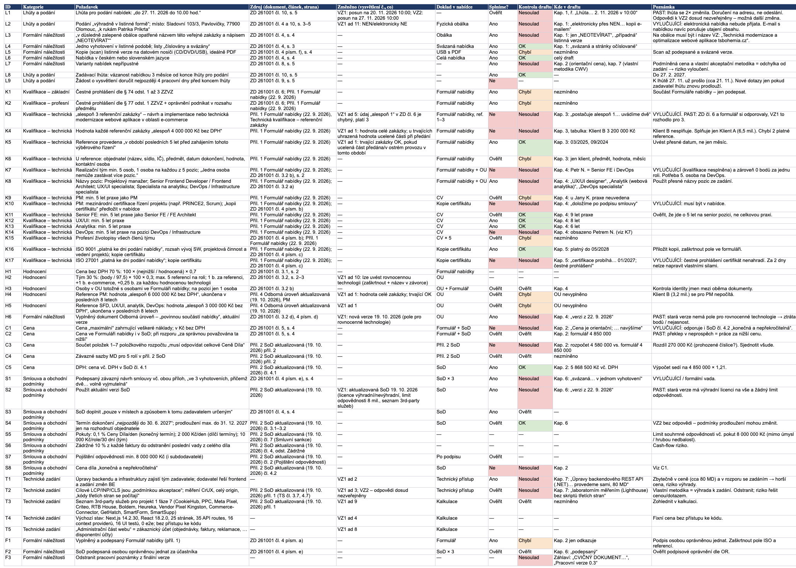

*Prompt a odpověď*

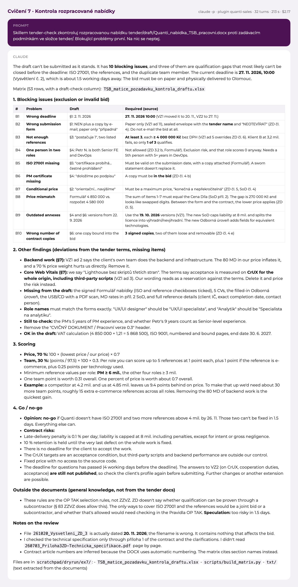

</details>

## 8. Vlastní skill (15 min)

Vyberte úkol, který děláte každý týden. S Claude:

```
Chci z tohoto postupu udělat skill pro náš tým: <popis, příklad dobrého výstupu, pravidla>.
Navrhni SKILL.md (název, popis, kroky, závěrečná kontrola) a vyzkoušej ho na tomto příkladu: <…>.
```

**Hotovo, když** máte `SKILL.md`, jehož popis používá slova, která váš tým opravdu říká,
a jeden testovací běh. Nasazení: [06-own-skill](06-own-skill.cs.md).
