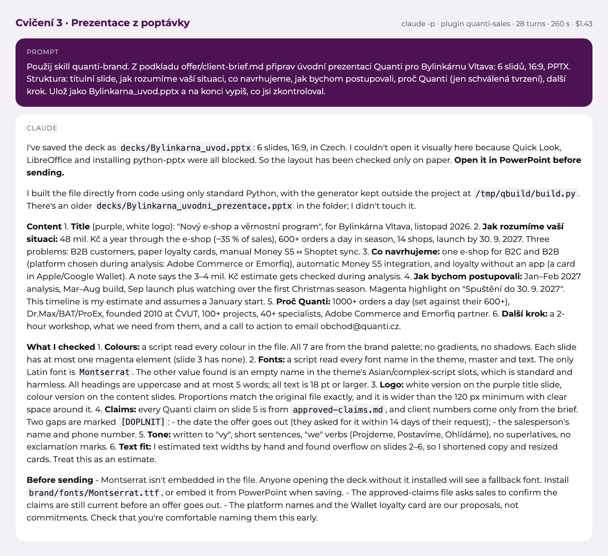
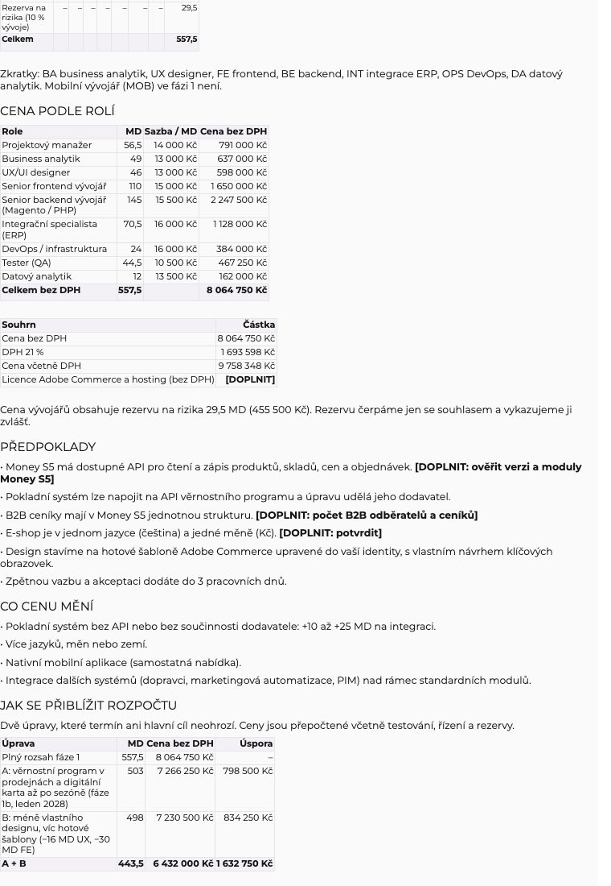

> 🌍 Read this in: **English** | [Česky](exercises.cs.md)

# Exercises

Each exercise: a prompt to paste (in Czech, as you would work), what to watch, and **Done
when**. Start a **new conversation** for each exercise and grant it the folder
`~/Documents/qti-cowork-sales/sample-data`. Answer keys are in `solutions/` (facilitator).

## 0. Setup (10 min)

Follow [01-setup](01-setup.md): plugin, folder, smoke test.

**Done when**
- `quanti-sales` with four skills is listed in Customize → Plugins.
- The smoke-test answer names `#DF2686`, `#4D1254`, Montserrat and the white-logo rule.

## 1. Tone of voice from real texts (20 min)

```
Ve složce tone-corpus/ je 58 veřejných textů Quanti. Popiš náš tón: 5–7 zásad, ke každé
dvojici „takhle ano / takhle ne“ s citací z korpusu, seznam slov, kterým se vyhýbáme, a jak
oslovujeme čtenáře. Pak to porovnej se sekcí Tone of voice ve skillu quanti-brand a navrhni
konkrétní úpravy skillu. Ulož jako brand/tone-of-voice.md.
```

With the `brand-voice` plugin installed, try `/brand-voice:generate-guidelines` on the same
folder and compare.

**Done when**
- Every principle has at least one real quote (search the corpus for one to verify).
- There is a list of concrete edits to the skill, not "looks good".

## 2. Design system from brand assets (20 min)

In **Settings → Capabilities → Design systems**, create a new design system and upload from
`brand/`: `brand-brief.md`, `tokens.json`, `quanti-logo.svg`, `quanti-logo-white.svg`,
`fonts/Montserrat-*.ttf`. Name it "Quanti". Do **not** publish it.

Then, in a new conversation using that design system:

```
Udělej jeden titulní slide a jeden obsahový slide pro úvodní schůzku s Bylinkárnou Vltava.
```

**Done when**
- The preview shows magenta `#DF2686` as the only accent, purple `#4D1254` for dark surfaces,
  Montserrat with uppercase headings.
- The title slide uses the white logo on purple.

## 3. A deck from a brief (25 min)

```
Použij skill quanti-brand. Z podkladu offer/client-brief.md připrav úvodní prezentaci Quanti
pro Bylinkárnu Vltava: 6 slidů, 16:9, PPTX. Struktura: titulní slide, jak rozumíme vaší
situaci, co navrhujeme, jak bychom postupovali, proč Quanti (jen schválená tvrzení), další
krok. Ulož jako Bylinkarna_uvod.pptx a na konci vypiš, co jsi zkontroloval.
```

**Done when**
- `Bylinkarna_uvod.pptx` opens with 6 slides in Montserrat; only palette colours.
- Slide 2 quotes the brief (14 prodejen, Money S5, 30. 9. 2027).
- "Proč Quanti" uses only claims from `approved-claims.md`; anything else is `[DOPLNIT]`.
- The last slide has one concrete next step.

<details><summary>Screenshots from the last dry run (2026-11-25)</summary>

*Deck, second run*


*Prompt and answer*



</details>

## 4. Review and fix an off-brand deck (20 min)

```
Zkontroluj prezentaci decks/Bylinkarna_uvodni_prezentace.pptx skillem deck-review.
```

Read the report, then:

```
Oprav ji podle zprávy a ulož s příponou _opraveno.
```

**Done when**
- The report finds at least 12 of the errors in `solutions/deck-review-key.md`, including the
  stretched logo, the colour logo on purple and the unapproved claims (200 mil. Kč, ISO 27001).
- The fixed deck has no blue, green, orange, Calibri or Times; claims are removed or `[DOPLNIT]`.

<details><summary>Screenshots from the last dry run (2026-11-25)</summary>

*Before*


*Review report*


*After the fix*


</details>

## 5. A priced offer (35 min)

```
Skillem quanti-offer připrav nabídku pro Bylinkárnu Vltava podle offer/client-brief.md a ceníku
offer/rate-card.xlsx (dodržuj pravidla na listu Pravidla). První fáze: e-shop B2C + B2B
napojený na Money S5 a věrnostní program bez nativní mobilní aplikace; platformu doporuč.
Výstup DOCX.
```

Answer Claude's questions if it asks (budget, deadline are in the brief).

**Done when**
- The DOCX follows the offer structure: summary, understanding, solution, plan, team, price,
  why Quanti, next steps.
- The price table shows MD × rate per role; PM = 12 % and QA = 15 % of the right base;
  totals excl. VAT, VAT 21 %, incl. VAT. Recompute one line yourself.
- Licences are `[DOPLNIT]`, not a guessed number.
- The hand-over report lists open `[DOPLNIT]`s and price-changing assumptions.

<details><summary>Screenshots from the last dry run (2026-11-25)</summary>

*Offer DOCX, all pages*


*Price section*



*Prompt and answer*


</details>

## 6. Tender requirements matrix and go/no-go (30 min)

```
Skillem tender-check zpracuj zakázku ve složce tender/ (všechny dokumenty včetně vysvětlení;
složku draft/ zatím ignoruj). Udělej soupis dokumentů, matici požadavků do Matice_TSB.xlsx,
vysvětli hodnocení a dej go/no-go pro Quanti.
```

**Done when** the matrix and the summary contain:
- the current deadline **27. 11. 2026 10:00** and how it moved;
- **3** references ≥ 4 M Kč excl. VAT (not the ZD's "1");
- the **updated** contract and Odborná úroveň (19. 10.) as the current versions;
- paper submission, envelope with tender name + "NEOTEVÍRAT", contract 3× (2 removable);
- ISO 9001 + ISO 27001, 5 different people, PM certificate;
- evaluation 70 % price / 30 % team, and the lower-price rule;
- CWV targets as an acceptance condition on CrUX data;
- each row with a source (document + article).

Compare with `solutions/tender-answer-key.md` (68 rows): what did Claude miss, what did it
add that is not in the documents?

<details><summary>Screenshots from the last dry run (2026-11-25)</summary>

*Requirements matrix*


*Prompt and answer*


</details>

## 7. Check a draft bid (20 min)

```
Skillem tender-check zkontroluj rozpracovanou nabídku tender/draft/Quanti_nabidka_TSB_pracovni.docx
proti zadávacím podmínkám ve složce tender/. Blokující problémy první.
```

**Done when**
- All blocking rows of `solutions/draft-bid-key.md` are found: old deadline, electronic
  submission, price mismatch (lower price prevails), "indicative" price, 2 references instead
  of 3, a reference under 4 M Kč, one person in two roles, missing PM certificate, ISO 27001
  in progress.
- ISO 9001 and the 30. 6. 2027 date are **not** flagged.

<details><summary>Screenshots from the last dry run (2026-11-25)</summary>

*Draft check in the matrix*


*Prompt and answer*


</details>

## 8. Your own skill (15 min)

Pick a task you repeat every week. With Claude:

```
Chci z tohoto postupu udělat skill pro náš tým: <popis, příklad dobrého výstupu, pravidla>.
Navrhni SKILL.md (název, popis, kroky, závěrečná kontrola) a vyzkoušej ho na tomto příkladu: <…>.
```

**Done when** you have a `SKILL.md` whose description uses the words your team actually says,
and one test run. Rollout: [06-own-skill](06-own-skill.md).
